## Household saving and income

How does saving vary with income, household size, and region?

Our outputs will be a checked dataset, two figures, and a descriptive table.
All records are synthetic. Income, consumption, and saving are EUR per month.


::: {.notes}
Clock 01:00–05:00 (4 minutes). Block: The research question. Connect to Assignment 1 without displaying its solutions. This second teaching day begins CSV loading from first principles.
:::

## The observation and its units

One household is one observation. A negative saving amount has an economic meaning.

```{.python}
income = 1000
consumption = 1100
saving = income - consumption
print(saving)
```

::: {.terminal-output .fragment}
```{.text}
-100
```
:::

::: {.notes}
Clock 05:00–09:00 (4 minutes). Block: The research question. Ask students to explain the output before running. The day develops descriptive comparisons, not causal inference.
:::

## A figure and its reader

Show the same observations with vague labels and with an informative presentation.

What do the axes measure? Where is zero saving? Which households enter the figure?

Keep these questions in mind while we prepare the data.


::: {.notes}
Clock 09:00–12:00 (3 minutes). Block: The research question. Preview the weak and revised plot in the design section, then return. Ask for a specific reading benefit rather than a favourite colour.
:::

## The research workflow

Question → inspect → prepare → summarise → plot → explain → reproduce

At each stage, make a check that addresses the calculation.
A plausible picture can conceal duplicated records or an incorrect denominator.


::: {.notes}
Clock 12:00–15:00 (3 minutes). Block: The research question. The six-hour clock excludes breaks and any independent test. Give students the notebook, CSV files, and README together.
:::

## Opening the lesson

Open codes/day-2/data_science.ipynb in the research-methods environment.
Start JupyterLab from codes/day-2/ and keep the data/ folder beside the notebook.

Before class, add plotnine in a terminal:

conda install -n research-methods -c conda-forge "plotnine>=0.15,<0.16"


::: {.notes}
Clock 15:00–20:00 (5 minutes). Block: First pandas dataset. This setup command belongs in a terminal. The README supplies new-environment and existing-environment instructions. Do the import check before teaching.
:::

## Imports and the working folder

Run the notebook from this lesson's folder.

```{.python}
from pathlib import Path
import pandas as pd
import plotnine as pn
from IPython.display import HTML, display
from plotnine import (
    ggplot, aes, geom_point, geom_hline, geom_histogram,
    geom_boxplot, geom_col, facet_wrap, labs,
    theme_minimal, theme_gray, theme, element_blank, coord_flip,
)
print(Path.cwd().name)
```

::: {.terminal-output .fragment}
```{.text}
day-2
```
:::

::: {.notes}
Clock 20:00–25:00 (5 minutes). Block: First pandas dataset. Explain the imports as making tools available. Parentheses allow a long import to span lines. Reference: https://pandas.pydata.org/docs/getting_started/intro_tutorials/
:::

## A CSV becomes a DataFrame

A DataFrame is a labelled table. Shape reports rows and columns.

```{.python}
raw = pd.read_csv("data/raw/households.csv")
print(raw.shape)
print(raw.columns.tolist())
```

::: {.terminal-output .fragment}
```{.text}
(201, 5)
['household_id', 'income', 'consumption', 'size', 'region_code']
```
:::

::: {.notes}
Clock 25:00–30:00 (5 minutes). Block: First pandas dataset. Open the CSV in a text editor first. Its header is not an observation. The raw income field deliberately contains invalid text.
:::

## Three observations

Identify the household ID, monetary columns, number of persons, and region code.

```{.python}
print(raw.head(3).to_string(index=False))
```

::: {.terminal-output .fragment}
```{.text}
household_id income  consumption  size region_code
        H001   1510       1610.0     1           N
        H002   1996       1620.0     2           S
        H003   4014       3200.0     3           E
```
:::

::: {.notes}
Clock 30:00–35:00 (5 minutes). Block: First pandas dataset. A row index is not a household identifier. The complete data dictionary is in data/README.md.
:::

## Types and missing entries

An invalid text token can prevent a money column from having a numeric type.

```{.python}
print(raw.dtypes.to_string())
print(raw.isna().sum().to_string())
```

::: {.terminal-output .fragment}
```{.text}
household_id        str
income              str
consumption     float64
size              int64
region_code         str
household_id    0
income          1
consumption     3
size            0
region_code     0
```
:::

::: {.notes}
Clock 35:00–40:00 (5 minutes). Block: First pandas dataset. Stored missing values and the literal word missing need different inspection steps. The precise string dtype display can differ by pandas version.
:::

## Column selection

A column name selects a Series. A list of names selects a DataFrame.

```{.python}
print(raw["size"].head(3).to_list())
money = raw[["income", "consumption"]]
print(money.shape)
```

::: {.terminal-output .fragment}
```{.text}
[1, 2, 3]
(201, 2)
```
:::

::: {.notes}
Clock 40:00–45:00 (5 minutes). Block: First pandas dataset. Read the nested brackets slowly and connect them to Python lists.
:::

## Row selection with loc

loc[row condition, columns] selects the desired observations and fields.

```{.python}
large = raw.loc[raw["size"] >= 4, ["household_id", "size"]]
print(large.head(3).to_string(index=False))
print(len(large))
```

::: {.terminal-output .fragment}
```{.text}
household_id  size
        H004     4
        H005     5
        H009     4
80
```
:::

::: {.notes}
Clock 45:00–50:00 (5 minutes). Block: First pandas dataset. The condition produces one Boolean per row. Compare with an if statement inside a loop.
:::

## Exercise 1: a subset

::: {.exercise}
Predict whether the result can contain a household of size one. Attempt before advancing.
:::

```{.python}
# Select size == 2 and region_code == "N".
# Keep household_id, size, and region_code.
# Print three rows and the number of selected observations.
```

::: {.notes}
Clock 50:00–58:00 (8 minutes). Block: First pandas dataset. Five minutes to attempt, three to compare. Introduce parenthesised conditions joined by & in the worked answer.
:::

## Worked example: two conditions

Each comparison operates across rows. Parentheses separate the conditions.

```{.python}
selected = raw.loc[
    (raw["size"] == 2) & (raw["region_code"] == "N"),
    ["household_id", "size", "region_code"],
]
print(selected.head(3).to_string(index=False))
print(len(selected))
```

::: {.terminal-output .fragment}
```{.text}
household_id  size region_code
        H017     2           N
        H037     2           N
        H057     2           N
10
```
:::

::: {.notes}
Clock 58:00–62:00 (4 minutes). Block: First pandas dataset. Use & for these Series comparisons rather than Python and. Reference: https://pandas.pydata.org/docs/getting_started/intro_tutorials/03_subset_data.html
:::

## An early plot from complete rows

This preview still contains the duplicate. We will define the analysis sample explicitly.

```{.python}
preview = raw.copy()
preview["income"] = pd.to_numeric(preview["income"], errors="coerce")
preview = preview.dropna(subset=["income", "consumption"]).copy()
preview["saving"] = preview["income"] - preview["consumption"]
preview_plot = ggplot(preview, aes("income", "saving")) + geom_point()
```

::: {.notes}
Clock 62:00–66:00 (4 minutes). Block: First pandas dataset. Give students an early visible result. Coerce converts unusable strings to missing numeric values.
:::

## The preview figure

{height=560 style="display:block;margin-inline:auto;" fig-alt="The preview figure. Synthetic classroom data."}

One point represents a row. Duplicate rows can overplot each other.

::: {.notes}
Clock 66:00–70:00 (4 minutes). Block: First pandas dataset. A plausible visible point count cannot verify the sample size. Ask which units a reader still needs.
:::

## Preserving the raw input

Transform an independent table and keep the supplied raw file unchanged.

```{.python}
clean = raw.copy()
print(raw.shape, clean.shape)
```

::: {.terminal-output .fragment}
```{.text}
(201, 5) (201, 5)
```
:::

::: {.notes}
Clock 70:00–76:00 (6 minutes). Block: Preparation and checks. Neither read_csv nor copy writes back to the file.
:::

## Exact duplicates and household IDs

An exact duplicate differs from a repeated ID with conflicting measurements.

```{.python}
print(clean.duplicated().sum())
print(clean["household_id"].duplicated().sum())
clean = clean.drop_duplicates().copy()
assert clean["household_id"].is_unique
print(len(clean))
```

::: {.terminal-output .fragment}
```{.text}
1
1
200
```
:::

::: {.notes}
Clock 76:00–82:00 (6 minutes). Block: Preparation and checks. The fixture has one exact duplicate. Conflicting records require investigation rather than automatically keeping the first ID.
:::

## Numeric conversion

Two income entries and three consumption entries are unusable after conversion.

```{.python}
clean["income"] = pd.to_numeric(clean["income"], errors="coerce")
print(clean[["income", "consumption"]].isna().sum().to_string())
```

::: {.terminal-output .fragment}
```{.text}
income         2
consumption    3
```
:::

::: {.notes}
Clock 82:00–88:00 (6 minutes). Block: Preparation and checks. A zero income is observed information. Missing or invalid input supplies no income measurement.
:::

## The exclusion record

Inspect the affected rows before deciding how to handle them.

```{.python}
incomplete = clean.loc[
    clean[["income", "consumption"]].isna().any(axis=1),
    ["household_id", "income", "consumption"],
]
print(incomplete.to_string(index=False))
```

::: {.terminal-output .fragment}
```{.text}
household_id  income  consumption
        H008     NaN       3860.0
        H023     NaN       1910.0
        H032  2068.0          NaN
        H068  4266.0          NaN
        H102  1738.0          NaN
```
:::

::: {.notes}
Clock 88:00–93:00 (5 minutes). Block: Preparation and checks. any(axis=1) asks whether one or more selected fields are missing within each row. Five distinct households are affected.
:::

## The complete-record policy

Explain how exclusions change the sample. Zero-filling would invent money values.

```{.python}
before = len(clean)
clean = clean.dropna(subset=["income", "consumption"]).copy()
print("Excluded:", before - len(clean), "Retained:", len(clean))
assert len(clean) == 195
assert (clean["size"] > 0).all()
assert (clean[["income", "consumption"]] >= 0).all().all()
```

::: {.terminal-output .fragment}
```{.text}
Excluded: 5 Retained: 195
```
:::

::: {.notes}
Clock 93:00–98:00 (5 minutes). Block: Preparation and checks. This is a declared classroom policy. In a research project justify exclusions and assess their consequences.
:::

## Vectorised calculations

Arithmetic operates element by element, matching the Series index labels.

```{.python}
clean["saving"] = clean["income"] - clean["consumption"]
clean["income_per_person"] = clean["income"] / clean["size"]
print(clean[["income", "consumption", "saving"]].head(3).to_string(index=False))
```

::: {.terminal-output .fragment}
```{.text}
 income  consumption  saving
 1510.0       1610.0  -100.0
 1996.0       1620.0   376.0
 4014.0       3200.0   814.0
```
:::

::: {.notes}
Clock 98:00–103:00 (5 minutes). Block: Preparation and checks. Connect to Day 1 functions. A vectorised expression makes the repeated calculation visible. Misaligned Series need special care.
:::

## Undefined shares

where retains positive denominators and makes the others missing.

```{.python}
denominator = clean["income"].where(clean["income"] > 0)
clean["saving_share"] = clean["saving"] / denominator
print("Zero incomes:", (clean["income"] == 0).sum())
print("Defined shares:", clean["saving_share"].notna().sum())
```

::: {.terminal-output .fragment}
```{.text}
Zero incomes: 2
Defined shares: 193
```
:::

::: {.notes}
Clock 103:00–108:00 (5 minutes). Block: Preparation and checks. There are two valid zero-income households. Saving amounts remain defined. The numeric share column uses a pandas missing value rather than zero.
:::

## Exercise 2: zero-income households

::: {.exercise}
Predict the selected count and distinguish missing inputs from undefined ratios.
:::

```{.python}
# Select zero-income households.
# Print income, consumption, saving, and saving_share.
# Explain whether to exclude them from saving-amount totals.
```

::: {.notes}
Clock 108:00–115:00 (7 minutes). Block: Preparation and checks. Four minutes to attempt, three to interpret.
:::

## Worked example: amounts and shares

Both households remain in amount summaries. Share summaries have a smaller denominator.

```{.python}
zero_income = clean.loc[
    clean["income"] == 0,
    ["income", "consumption", "saving", "saving_share"],
]
print(zero_income.to_string(index=False))
assert zero_income["saving_share"].isna().all()
```

::: {.terminal-output .fragment}
```{.text}
 income  consumption  saving  saving_share
    0.0       2080.0 -2080.0           NaN
    0.0       1570.0 -1570.0           NaN
```
:::

::: {.notes}
Clock 115:00–120:00 (5 minutes). Block: Preparation and checks. Removing these households globally would change the total saving amount.
:::

## A region lookup

Each code maps to one region name. Many households can have the same code.

```{.python}
regions = pd.read_csv("data/raw/regions.csv")
print(regions.to_string(index=False))
assert regions["region_code"].is_unique
```

::: {.terminal-output .fragment}
```{.text}
region_code region
          N  North
          S  South
          E   East
          W   West
```
:::

::: {.notes}
Clock 120:00–127:00 (7 minutes). Block: Summaries and joins. Distinguish the lookup key from the household ID. Reference: https://pandas.pydata.org/docs/user_guide/merging.html
:::

## A checked left join

Cardinality and match checks protect the household sample.

```{.python}
n_before = len(clean)
df = clean.merge(
    regions, on="region_code", how="left",
    validate="many_to_one", indicator=True,
)
assert len(df) == n_before
assert df["_merge"].eq("both").all()
print(df["_merge"].value_counts().to_string())
```

::: {.terminal-output .fragment}
```{.text}
_merge
both          195
left_only       0
right_only      0
```
:::

::: {.notes}
Clock 127:00–133:00 (6 minutes). Block: Summaries and joins. Explain left, key, many_to_one, and the match indicator. A left join alone cannot prevent duplicate lookup rows from multiplying observations.
:::

## A duplicate key multiplies records

Extra rows can silently change the weights in a statistic.

```{.python}
bad_lookup = pd.concat([regions, regions.iloc[[0]]], ignore_index=True)
unchecked = clean.merge(bad_lookup, on="region_code", how="left")
print("Before:", len(clean), "After:", len(unchecked))
```

::: {.terminal-output .fragment}
```{.text}
Before: 195 After: 245
```
:::

::: {.notes}
Clock 133:00–139:00 (6 minutes). Block: Summaries and joins. The original lookup remains unchanged. A validated many_to_one join with this bad lookup raises MergeError. Try that deliberate error in a scratch cell.
:::

## Grouped summaries

size counts group rows. count counts non-missing values in the selected column.

```{.python}
summary = df.groupby("region", as_index=False).agg(
    n_households=("household_id", "size"),
    mean_saving=("saving", "mean"),
    median_saving=("saving", "median"),
    n_shares=("saving_share", "count"),
    mean_share=("saving_share", "mean"),
)
print(summary.round(2).to_string(index=False))
```

::: {.terminal-output .fragment}
```{.text}
region  n_households  mean_saving  median_saving  n_shares  mean_share
  East            49       351.84          366.0        48        0.12
 North            50       223.12          171.0        49        0.10
 South            49       351.04          212.0        49        0.11
  West            47       274.91          109.0        47        0.07
```
:::

::: {.notes}
Clock 139:00–145:00 (6 minutes). Block: Summaries and joins. Read named aggregation as output name = (input column, calculation). State the denominator beside each mean.
:::

## Mean household share and pooled share

The household mean weights defined ratios equally. The pooled measure compares total saving with total income.

```{.python}
mean_share = df["saving_share"].mean()
pooled_share = df["saving"].sum() / df["income"].sum()
print(f"Household mean: {mean_share:.2%}")
print(f"Pooled share: {pooled_share:.2%}")
print("Households:", len(df), "Defined shares:", df["saving_share"].count())
```

::: {.terminal-output .fragment}
```{.text}
Household mean: 9.91%
Pooled share: 9.60%
Households: 195 Defined shares: 193
```
:::

::: {.notes}
Clock 145:00–151:00 (6 minutes). Block: Summaries and joins. In this fixture the pooled totals also include consumption of zero-income households. The two measures differ in weighting and sample treatment. Explain the question each answers.
:::

## Exercise 3: a regional shortfall rate

::: {.exercise}
A Boolean mean is the fraction of True observations. Explain its denominator.
:::

```{.python}
# Create negative_saving = saving < 0.
# For each region, calculate count and the fraction with negative saving.
# Include the zero-income households.
```

::: {.notes}
Clock 151:00–159:00 (8 minutes). Block: Summaries and joins. Five minutes for code, three to compare. The shortfall flag is defined for all 195 retained households.
:::

## Worked example: a Boolean group mean

A value of 0.20 would mean 20% of that region's retained households.

```{.python}
df["negative_saving"] = df["saving"] < 0
shortfalls = df.groupby("region", as_index=False).agg(
    households=("household_id", "size"),
    shortfall_rate=("negative_saving", "mean"),
)
print(shortfalls.round(3).to_string(index=False))
```

::: {.terminal-output .fragment}
```{.text}
region  households  shortfall_rate
  East          49           0.245
 North          50           0.300
 South          49           0.245
  West          47           0.383
```
:::

::: {.notes}
Clock 159:00–165:00 (6 minutes). Block: Summaries and joins. Ask why the count of defined saving shares would be the wrong denominator for this flag.
:::

## The plot components

- Data supplies observations.
- Aesthetic mappings connect columns to position, colour, or size.
- Geometric objects draw the marks.
- Statistical transformations calculate counts or summaries.
- Scales, facets, and coordinates organise comparisons.
- A theme controls surrounding presentation.


::: {.notes}
Clock 165:00–169:00 (4 minutes). Block: Grammar of graphics. Aesthetics here means variable-to-visual mappings. Explain this before discussing visual polish. Reference: https://plotnine.org/guide/aesthetic-mappings.html
:::

## Data and position mappings

The point layer inherits the data and mappings. The + operator combines plotting components.

```{.python}
base = ggplot(df, aes(x="income", y="saving"))
points = base + geom_point()
```

::: {.notes}
Clock 169:00–173:00 (4 minutes). Block: Grammar of graphics. The names inside aes refer to columns. Parentheses allow a specification to span lines.
:::

## The point layer

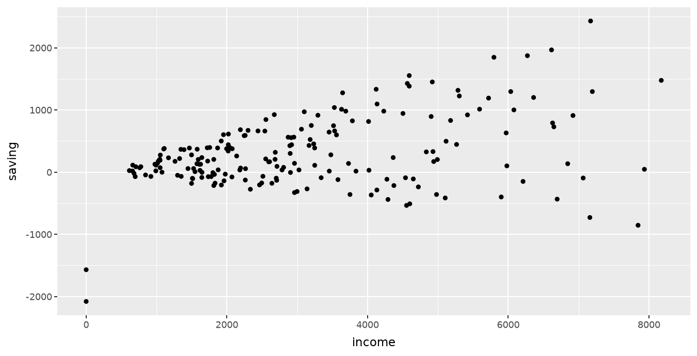{height=560 style="display:block;margin-inline:auto;" fig-alt="The point layer. Synthetic classroom data."}

Which units and reference values would help the reader?

::: {.notes}
Clock 173:00–177:00 (4 minutes). Block: Grammar of graphics. Describe these synthetic observations without inferring causality.
:::

## A constant colour

A setting outside aes applies the same colour to every point.

```{.python}
constant = base + geom_point(color="#245b78", alpha=0.6)
```

::: {.notes}
Clock 177:00–181:00 (4 minutes). Block: Grammar of graphics. Alpha is opacity. Partial transparency helps with overlap.
:::

## Colour mapped to region

A mapping varies the graphical attribute with the variable and supplies a guide.

```{.python}
coloured = (
    ggplot(df, aes("income", "saving", color="region"))
    + geom_point(alpha=0.6)
    + labs(color="Region")
)
```

::: {.notes}
Clock 181:00–184:00 (3 minutes). Block: Grammar of graphics. Contrast the region column mapping with a fixed colour setting. Reference: https://plotnine.org/guide/aesthetic-mappings.html
:::

## The region colour mapping

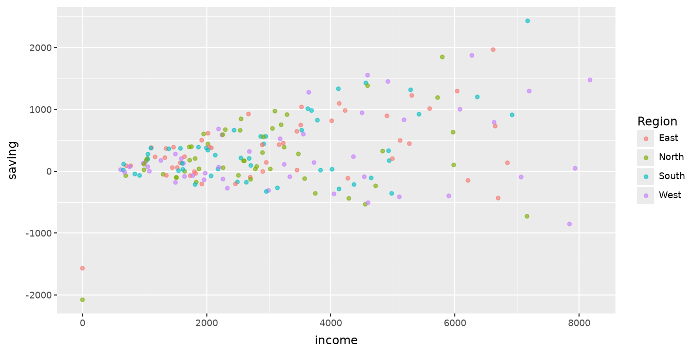{height=560 style="display:block;margin-inline:auto;" fig-alt="The region colour mapping. Synthetic classroom data."}

The legend explains the mapping. Overlap may make group comparisons difficult.

::: {.notes}
Clock 184:00–187:00 (3 minutes). Block: Grammar of graphics. Ask students to follow the observations of one region.
:::

## Facets and shared scales

Facets repeat a design across groups. Fixed scales support comparisons.

```{.python}
faceted = (
    base + geom_point(color="#245b78", alpha=0.6)
    + facet_wrap("region", ncol=2)
    + theme_minimal(base_size=16)
)
```

::: {.notes}
Clock 187:00–190:00 (3 minutes). Block: Grammar of graphics. A redundant colour legend can be removed when panels already identify region.
:::

## The regional panels

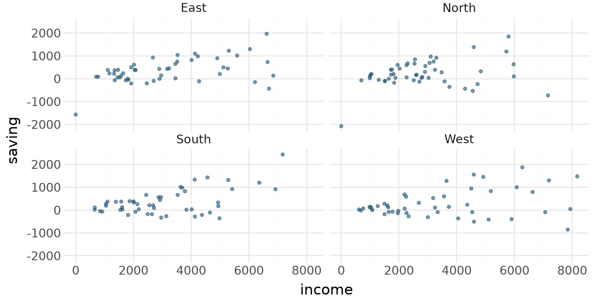{height=560 style="display:block;margin-inline:auto;" fig-alt="The regional panels. Synthetic classroom data."}

Every retained household appears in exactly one panel.

::: {.notes}
Clock 190:00–193:00 (3 minutes). Block: Grammar of graphics. Explain what independent scales would change before considering them.
:::

## A distribution plot

The histogram calculates counts within bins. The bin width is an analytical choice.

```{.python}
histogram = (
    ggplot(df, aes("saving"))
    + geom_histogram(binwidth=250, boundary=0, fill="#245b78")
    + labs(x="Monthly saving (EUR)", y="Households")
    + theme_minimal(base_size=16)
)
```

::: {.notes}
Clock 193:00–196:00 (3 minutes). Block: Grammar of graphics. Discuss the computed y statistic and predict the effect of doubling the width.
:::

## The saving distribution

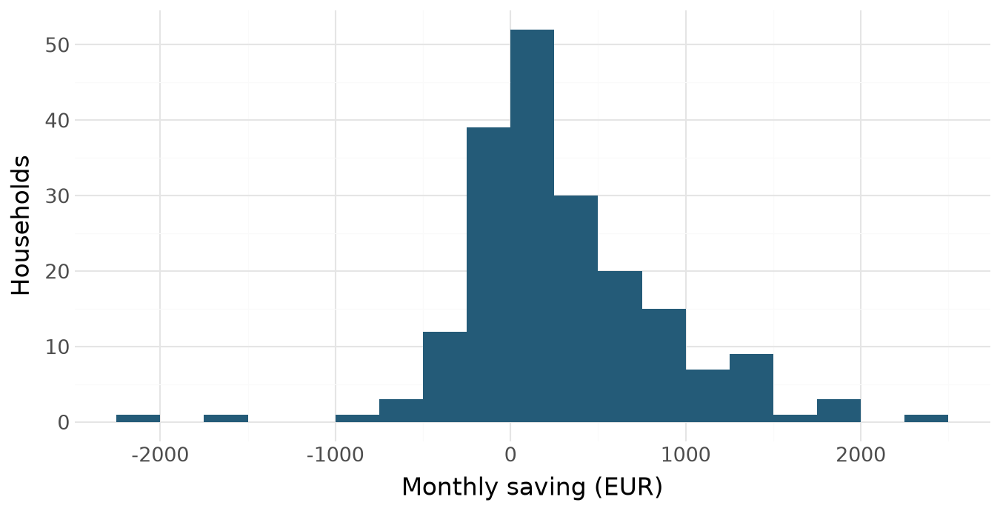{height=560 style="display:block;margin-inline:auto;" fig-alt="The saving distribution. Synthetic classroom data."}

All retained households have defined saving amounts, including negative amounts.

::: {.notes}
Clock 196:00–199:00 (3 minutes). Block: Grammar of graphics. A source note is needed when sharing this exploratory plot.
:::

## A supplied summary height

geom_col uses supplied heights. geom_bar normally counts observations.

```{.python}
regional_bars = (
    ggplot(summary, aes("region", "mean_saving"))
    + geom_col(fill="#245b78")
    + labs(x="Region", y="Mean monthly saving (EUR)")
    + theme_minimal(base_size=16)
)
```

::: {.notes}
Clock 199:00–202:00 (3 minutes). Block: Grammar of graphics. The four rows now represent regions rather than households. Source: https://plotnine.org/reference/geom_col.html
:::

## Regional means

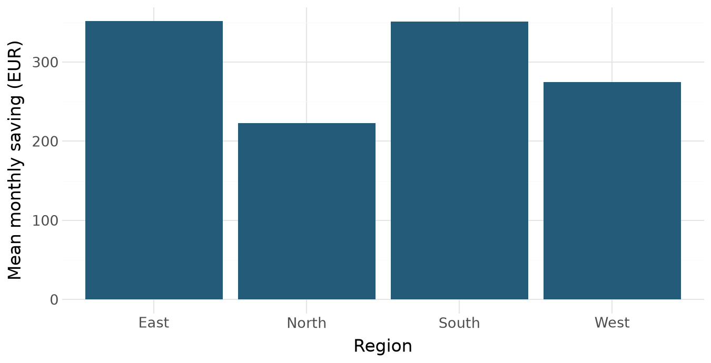{height=560 style="display:block;margin-inline:auto;" fig-alt="Regional means. Synthetic classroom data."}

The bars compare mean saving amounts. Their baseline represents zero.

::: {.notes}
Clock 202:00–205:00 (3 minutes). Block: Grammar of graphics. Ask where the statistic was computed and which households entered it.
:::

## Within-region variation

Boxplots summarise distributions. Their centres indicate medians.

```{.python}
boxes = (
    ggplot(df, aes("region", "saving"))
    + geom_boxplot(fill="#b9d3df", outlier_alpha=0.4)
    + labs(x="Region", y="Monthly saving (EUR)")
    + theme_minimal(base_size=16)
)
```

::: {.notes}
Clock 205:00–208:00 (3 minutes). Block: Grammar of graphics. Explain quartiles and the 1.5 IQR whisker convention. An outside point is not automatically bad data.
:::

## Regional distributions

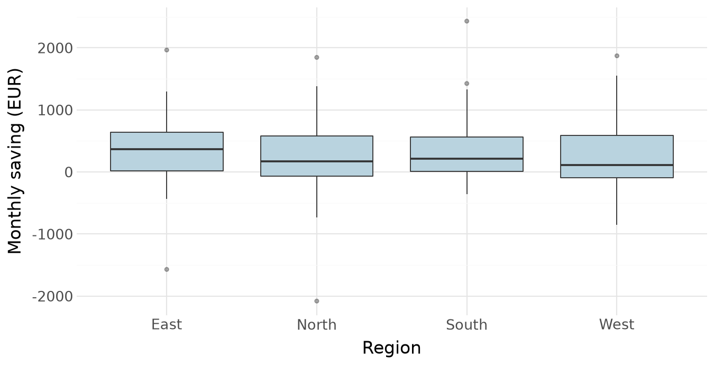{height=560 style="display:block;margin-inline:auto;" fig-alt="Regional distributions. Synthetic classroom data."}

Compare medians and spread. The whiskers do not show confidence intervals for a mean.

::: {.notes}
Clock 208:00–211:00 (3 minutes). Block: Grammar of graphics. Statistical meaning must accompany attractive presentation.
:::

## Exercise 4: faceted histograms

::: {.exercise}
Predict how doubling the bin width would change the picture.
:::

```{.python}
# Plot saving with 250 EUR bins.
# Make one panel per region with common axes.
# Label the money axis and household counts.
```

::: {.notes}
Clock 211:00–219:00 (8 minutes). Block: Grammar of graphics. Five minutes to attempt, three to compare. Keep zero-income households because the plot uses saving amounts.
:::

## Worked example: conditional distributions

Common bins and scales make the panels comparable.

```{.python}
regional_hist = (
    ggplot(df, aes("saving"))
    + geom_histogram(binwidth=250, boundary=0, fill="#245b78")
    + facet_wrap("region", ncol=2)
    + labs(x="Monthly saving (EUR)", y="Households")
    + theme_minimal(base_size=16)
)
```

::: {.notes}
Clock 219:00–222:00 (3 minutes). Block: Grammar of graphics. Raw counts also reflect each region's retained sample size.
:::

## The faceted distributions

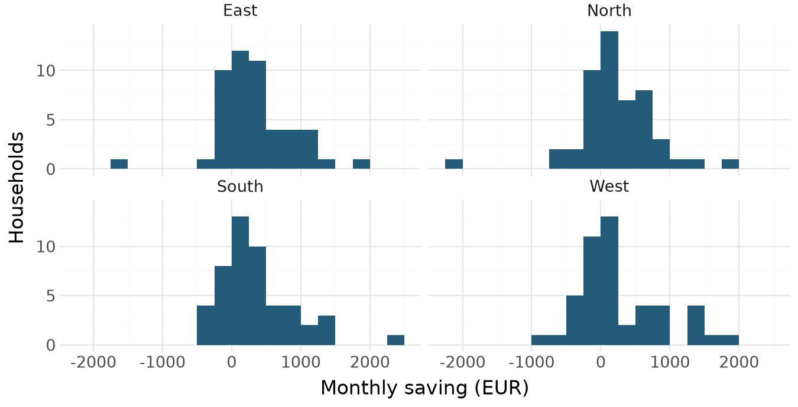{height=560 style="display:block;margin-inline:auto;" fig-alt="The faceted distributions. Synthetic classroom data."}

Each panel describes the distribution within one region.

::: {.notes}
Clock 222:00–225:00 (3 minutes). Block: Grammar of graphics. Counts are not automatically within-region probabilities. Always identify what the y axis measures.
:::

## A weak presentation

The observations are correct, but the reader receives little context.

```{.python}
bad = (
    base + geom_point(color="#ef5350", size=5)
    + labs(title="Results", x="x", y="y")
    + theme_gray(base_size=12)
)
```

::: {.notes}
Clock 225:00–229:00 (4 minutes). Block: Figure design and communication. This deliberately weak chart is a design exercise, not an invalid-data example.
:::

## A chart for redesign

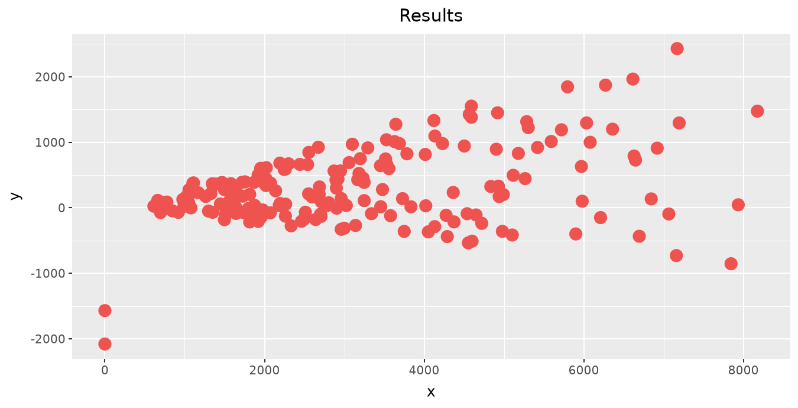{height=560 style="display:block;margin-inline:auto;" fig-alt="A chart for redesign. Synthetic classroom data."}

Identify three concrete changes that would help a reader.

::: {.notes}
Clock 229:00–233:00 (4 minutes). Block: Figure design and communication. Collect comments on units, vague title, overlap, zero reference, and sample information.
:::

## Labels, reference line, and source

A reference line marks zero saving. A source note declares what the reader sees.

```{.python}
good = (
    base + geom_hline(yintercept=0, color="#777777", size=0.5)
    + geom_point(color="#245b78", alpha=0.6, size=1.8)
    + labs(title="Household saving and income",
           x="Monthly income (EUR)", y="Monthly saving (EUR)",
           caption=f"Synthetic classroom data; n = {len(df)} households")
    + theme_minimal(base_size=16)
)
```

::: {.notes}
Clock 233:00–237:00 (4 minutes). Block: Figure design and communication. The reference line is context, not a fitted relationship. The chart uses the same rows as bad.
:::

## The revised presentation

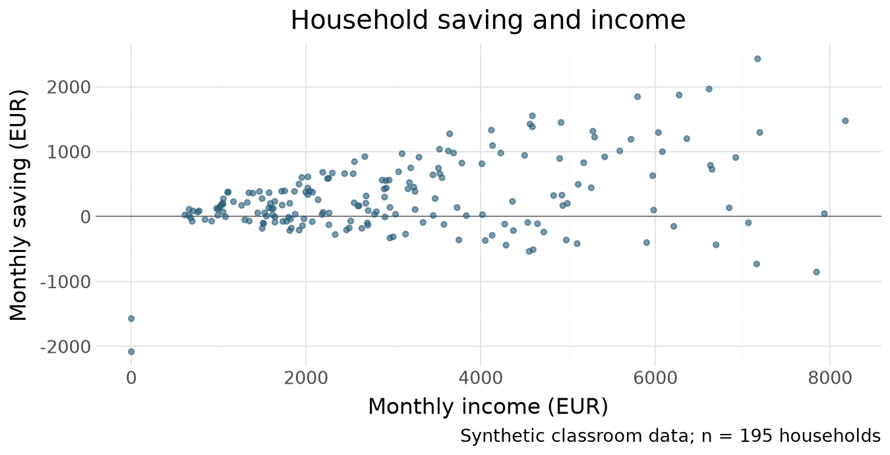{height=560 style="display:block;margin-inline:auto;" fig-alt="The revised presentation. Synthetic classroom data."}

The observations and calculations are unchanged.

::: {.notes}
Clock 237:00–241:00 (4 minutes). Block: Figure design and communication. Ask students to justify each design decision in terms of reading or interpretation.
:::

## Scale decisions

A positive-only saving axis would hide meaningful observations.

```{.python}
print("Minimum saving:", df["saving"].min())
print("Negative-saving households:", (df["saving"] < 0).sum())
```

::: {.terminal-output .fragment}
```{.text}
Minimum saving: -2080.0
Negative-saving households: 57
```
:::

::: {.notes}
Clock 241:00–245:00 (4 minutes). Block: Figure design and communication. Bars need a meaningful zero baseline. Scatterplots can zoom when labelled honestly. Distinguish coord_cartesian display zoom from scale limits that remove observations before statistical transformations.
:::

## An explicit category order

Sorting rows alone does not guarantee a plotting library's discrete-axis order.

```{.python}
region_order = summary.sort_values("mean_saving")["region"].tolist()
ordered_summary = summary.copy()
ordered_summary["region"] = pd.Categorical(
    ordered_summary["region"], categories=region_order, ordered=True
)
```

::: {.notes}
Clock 245:00–249:00 (4 minutes). Block: Figure design and communication. The ordered category makes the intended comparison explicit.
:::

## An ordered horizontal chart

Horizontal category labels support comparison.

```{.python}
ordered_plot = (
    ggplot(ordered_summary, aes("region", "mean_saving"))
    + geom_col(fill="#245b78") + coord_flip()
    + labs(x="Region", y="Mean monthly saving (EUR)")
    + theme_minimal(base_size=16)
)
```

::: {.notes}
Clock 249:00–253:00 (4 minutes). Block: Figure design and communication. Coordinate flipping changes orientation while mappings retain their original x and y variable roles.
:::

## The ordered comparison

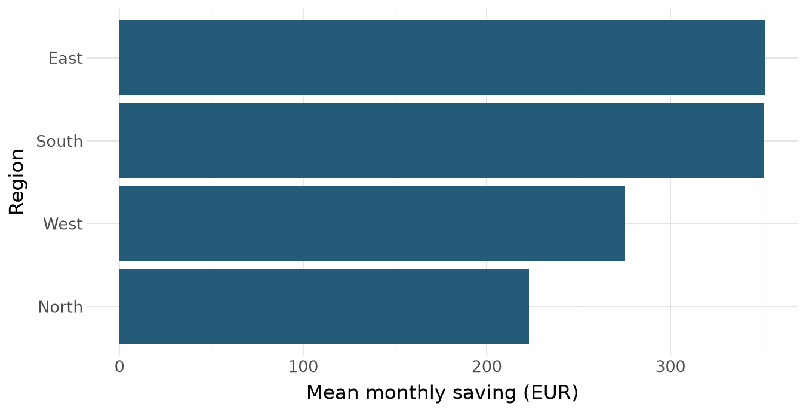{height=560 style="display:block;margin-inline:auto;" fig-alt="The ordered comparison. Synthetic classroom data."}

State the statistic and sample when presenting the chart.

::: {.notes}
Clock 253:00–256:00 (3 minutes). Block: Figure design and communication. Compare with the alphabetical version. Do not generalise the synthetic regional differences.
:::

## Exercise 5: design for projection

::: {.exercise}
Use theme(panel_grid_minor=element_blank()). Explain the reading benefit of each choice.
:::

```{.python}
# Start from good and facet by region.
# Keep common scales and increase text size.
# Remove minor gridlines.
```

::: {.notes}
Clock 256:00–264:00 (8 minutes). Block: Figure design and communication. Five minutes for code, three for discussion. Keep units, zero reference, and source note.
:::

## Worked example: a presentation figure

Inspect the result at the intended display size.

```{.python}
slide_plot = (
    good + facet_wrap("region", ncol=2)
    + theme(text=pn.element_text(size=18),
            panel_grid_minor=element_blank())
)
```

::: {.notes}
Clock 264:00–267:00 (3 minutes). Block: Figure design and communication. A theme change cannot repair an incorrect denominator. The pn alias was imported in the setup cell.
:::

## The presentation figure

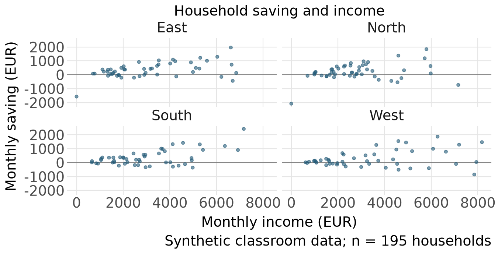{height=560 style="display:block;margin-inline:auto;" fig-alt="The presentation figure. Synthetic classroom data."}

The data, units, zero reference, and source note remain visible.

::: {.notes}
Clock 267:00–270:00 (3 minutes). Block: Figure design and communication. Check that the text is legible from the back of a classroom.
:::

## A table for the reader

Give the statistic, units, and sample.

Report household counts beside counts of defined shares.
Use consistent precision and explain exclusions.
Keep full precision for calculations and round the display.


::: {.notes}
Clock 270:00–275:00 (5 minutes). Block: Numerical results and tables. Ask which questions are easier to answer from a table than a scatterplot.
:::

## The numerical summary

The two counts identify the denominators used by the money and share summaries.

```{.python}
table = summary.copy()
print(table.round(2).to_string(index=False))
```

::: {.terminal-output .fragment}
```{.text}
region  n_households  mean_saving  median_saving  n_shares  mean_share
  East            49       351.84          366.0        48        0.12
 North            50       223.12          171.0        49        0.10
 South            49       351.04          212.0        49        0.11
  West            47       274.91          109.0        47        0.07
```
:::

::: {.notes}
Clock 275:00–280:00 (5 minutes). Block: Numerical results and tables. Rounding a displayed copy preserves the underlying analysis.
:::

## Readable percentage labels

Convert a fractional share to a percentage display exactly once.

```{.python}
display_table = table.copy()
display_table["Mean share (%)"] = 100 * display_table["mean_share"]
display_table = display_table.rename(columns={
    "region": "Region", "n_households": "Households",
    "n_shares": "Defined shares", "mean_saving": "Mean saving (EUR)",
})
```

::: {.notes}
Clock 280:00–284:00 (4 minutes). Block: Numerical results and tables. A percentage-point difference differs from a proportional change. Do not multiply twice when using percentage-format strings.
:::

## A compact display table

Note: synthetic, unweighted 2026 households. Five incomplete money records excluded after removing one exact duplicate.

```{.python}
columns = ["Region", "Households", "Defined shares",
           "Mean saving (EUR)", "Mean share (%)"]
html_table = display_table[columns].to_html(
    index=False, float_format=lambda value: f"{value:.1f}"
)
display(HTML(html_table))
```

::: {.fragment}
<table style="font-size:30px; width:100%;" border="1" class="dataframe">
  <thead>
    <tr style="text-align: right;">
      <th>Region</th>
      <th>Households</th>
      <th>Defined shares</th>
      <th>Mean saving (EUR)</th>
      <th>Mean share (%)</th>
    </tr>
  </thead>
  <tbody>
    <tr>
      <td>East</td>
      <td>49</td>
      <td>48</td>
      <td>351.8</td>
      <td>12.3</td>
    </tr>
    <tr>
      <td>North</td>
      <td>50</td>
      <td>49</td>
      <td>223.1</td>
      <td>9.5</td>
    </tr>
    <tr>
      <td>South</td>
      <td>49</td>
      <td>49</td>
      <td>351.0</td>
      <td>10.6</td>
    </tr>
    <tr>
      <td>West</td>
      <td>47</td>
      <td>47</td>
      <td>274.9</td>
      <td>7.1</td>
    </tr>
  </tbody>
</table>
:::

::: {.notes}
Clock 284:00–288:00 (4 minutes). Block: Numerical results and tables. The table note identifies source, weighting, and sample. Display precision is a communication decision.
:::

## Exercise 6: median income per person

::: {.exercise}
Label the new result as EUR per person per month.
:::

```{.python}
# Calculate median income per person by region.
# Join this four-row result to table using region.
# Verify four rows and no unmatched regions.
```

::: {.notes}
Clock 288:00–296:00 (8 minutes). Block: Numerical results and tables. Five minutes to attempt, three to discuss. This summary join is one-to-one.
:::

## Worked example: combining summaries

The key checks prevent accidental multiplication of summary rows.

```{.python}
medians = df.groupby("region", as_index=False).agg(
    median_income_per_person=("income_per_person", "median")
)
extended = table.merge(
    medians, on="region", how="left", validate="one_to_one"
)
assert len(extended) == 4
assert extended["median_income_per_person"].notna().all()
median_columns = ["region", "median_income_per_person"]
print(extended[median_columns].round(1).to_string(index=False))
```

::: {.terminal-output .fragment}
```{.text}
region  median_income_per_person
  East                    1151.0
 North                    1007.5
 South                     998.0
  West                    1131.0
```
:::

::: {.notes}
Clock 296:00–300:00 (4 minutes). Block: Numerical results and tables. Keep analysis names explicit and apply reader-friendly labels when exporting the table.
:::

## Export dimensions and formats

PNG suits screens. PDF preserves vector marks for print. Inspect exports at their intended size.

```{.python}
output = Path("outputs")
output.mkdir(exist_ok=True)
good.save(output / "saving_income.png", width=8, height=4.5,
          dpi=200, verbose=False)
good.save(output / "saving_income.pdf", width=8, height=4.5,
          verbose=False)
```

::: {.notes}
Clock 300:00–305:00 (5 minutes). Block: Reproducible workflow. Only generated outputs are written. Width and height default to inches. Reference: https://plotnine.org/reference/ggplot.html
:::

## Unrounded numerical exports

index=False avoids an unintended row-index column.

```{.python}
summary.to_csv(output / "regional_summary.csv", index=False)
clean.to_csv(output / "checked_households.csv", index=False)
(output / "regional_table.html").write_text(html_table)
print((output / "regional_summary.csv").is_file())
```

::: {.terminal-output .fragment}
```{.text}
True
```
:::

::: {.notes}
Clock 305:00–310:00 (5 minutes). Block: Reproducible workflow. Preserve the raw files. The checked table retains the lookup key so that the region join can be reproduced.
:::

## Exercise 7: an independent report

::: {.exercise}
Answer how saving differs across regions.

1. Rebuild the checked sample from the raw CSVs.
2. Produce one labelled table and two figures with different purposes.
3. Include units, sample counts, and the synthetic-data note.
4. Add four meaningful checks and explain the design choices.
5. Save the outputs and restart the notebook.

This is classroom practice, separate from graded take-home work.
:::


::: {.notes}
Clock 310:00–335:00 (25 minutes). Block: Reproducible workflow. Eighteen minutes of work and seven for peer explanation. One chart should show a distribution and one an association or group comparison.
:::

## Worked workflow: preparing the sample

This cell starts from files rather than remembered notebook values.

```{.python}
fresh = pd.read_csv("data/raw/households.csv").drop_duplicates()
fresh["income"] = pd.to_numeric(fresh["income"], errors="coerce")
fresh = fresh.dropna(subset=["income", "consumption"]).copy()
assert fresh["household_id"].is_unique
assert (fresh["size"] > 0).all()
fresh["saving"] = fresh["income"] - fresh["consumption"]
positive_income = fresh["income"].where(fresh["income"] > 0)
fresh["saving_share"] = fresh["saving"] / positive_income
```

::: {.notes}
Clock 335:00–340:00 (5 minutes). Block: Reproducible workflow. State the cleaning policy before running. The row count is specific to this deterministic fixture.
:::

## Worked workflow: the region join

Check the cardinality and match status before reporting results.

```{.python}
lookup = pd.read_csv("data/raw/regions.csv")
fresh = fresh.merge(
    lookup, on="region_code", how="left",
    validate="many_to_one", indicator=True,
)
assert len(fresh) == 195
assert fresh["_merge"].eq("both").all()
assert fresh["saving_share"].count() == 193
```

::: {.notes}
Clock 340:00–345:00 (5 minutes). Block: Reproducible workflow. A failed check calls for investigation rather than suppression.
:::

## Worked workflow: a final table

A final report explains both its pattern and the decisions that produced it.

```{.python}
final_summary = fresh.groupby("region", as_index=False).agg(
    households=("household_id", "size"),
    mean_saving=("saving", "mean"),
    defined_shares=("saving_share", "count"),
)
assert final_summary["households"].sum() == len(fresh)
final_summary.to_csv(output / "lab_summary.csv", index=False)
```

::: {.notes}
Clock 345:00–350:00 (5 minutes). Block: Reproducible workflow. The earlier histogram and relationship examples supply the two worked figures. Both can be regenerated directly using fresh instead of df.
:::

## A bounded coding-agent task

::: {.exercise}
Ask an agent to improve only the labels and theme of one figure.

Keep the sample, calculations, mappings, and scales fixed.
Inspect the change and verify the sample count.
Explain one design decision you accepted and the check you performed.
:::


::: {.notes}
Clock 350:00–355:00 (5 minutes). Block: Reproducible workflow. Discuss whether a changed bin width or an excluded negative value would fall within that request. Such analytical changes need separate justification.
:::

## The final reproducibility check

Restart and run all cells in order.

Can another student reproduce your table and two figures from the supplied files?
Can you explain every exclusion, denominator, mapping, and design choice?
Does each title make a claim supported by the displayed result?


::: {.notes}
Clock 355:00–360:00 (5 minutes). Block: Reproducible workflow. Close with a two-sentence interpretation and one limitation. Synthetic unweighted descriptive comparisons do not establish causation. Primary references are linked in the README.
:::
