## The data for the first figure

Open 04_grammar.ipynb. One row is one synthetic household. Money is EUR per month.

```{.python}
import plotnine as pn
pn.theme_set(pn.theme_gray(base_size=16))
from lesson_data import load_households
df = load_households()
columns = ["income", "saving", "region"]
print(df[columns].head(3).to_string(index=False))
print("Households:", len(df))
```

::: {.terminal-output .fragment}
```{.text code-line-numbers="false"}
 income  saving region
 1510.0  -100.0  North
 1996.0   376.0  South
 4014.0   814.0   East
Households: 195
```
:::

::: {.notes}
Clock 01:00–03:00 (2 minutes). The helper repeats the preparation taught in Lecture 8. The alias pn identifies plotnine functions. No plotting knowledge is assumed.
:::

## Data, mapping, and a point layer

ggplot supplies the data. aes maps columns to x and y. geom_point draws the rows.

:::: {.columns}
::: {.column width="48%"}
```{.python}
p = (
    pn.ggplot(
        df,
        pn.aes("income", "saving")
    )
    + pn.geom_point()
)
p
```

:::
::: {.column width="52%"}
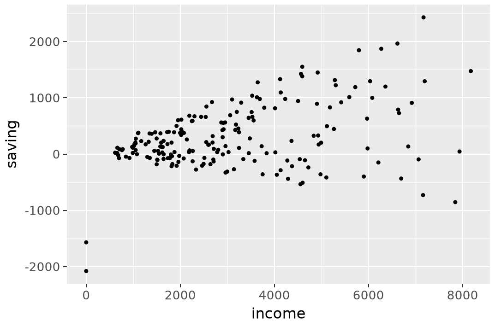{height=480 fig-alt="Data, mapping, and a point layer" style="display:block;margin-inline:auto;"}
:::
::::

::: {.notes}
Clock 03:00–07:00 (4 minutes). Trace the first household: x1510, y-100. The code is the figure specification. Parentheses let the expression continue across lines. Reference: https://plotnine.org/guide/aesthetic-mappings.html
:::

## Changing the mapping swaps the axes

The observations stay the same. The positions change.

:::: {.columns}
::: {.column width="48%"}
```{.python}
p = (
    pn.ggplot(
        df, pn.aes(
            x="saving", y="income"
        )
    )
    + pn.geom_point()
)
p
```

:::
::: {.column width="52%"}
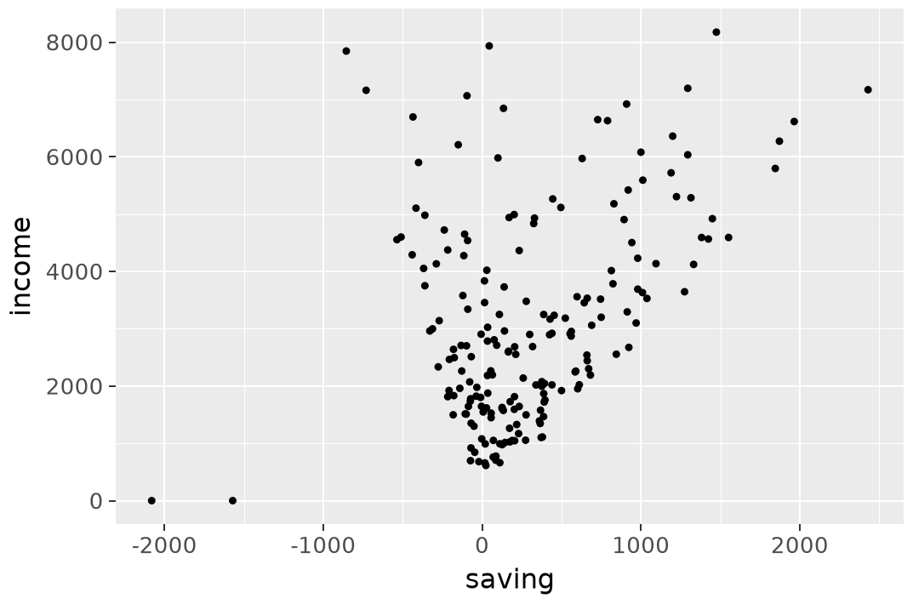{height=480 fig-alt="Changing the mapping swaps the axes" style="display:block;margin-inline:auto;"}
:::
::::

::: {.notes}
Clock 07:00–09:00 (2 minutes). Ask where the zero-income households moved. Explicit x= and y= make the roles visible.
:::

## A constant colour belongs outside aes

Every point uses the same blue. alpha controls opacity.

:::: {.columns}
::: {.column width="48%"}
```{.python}
base = pn.ggplot(
    df, pn.aes("income", "saving")
)
p = base + pn.geom_point(
    color="#245b78", alpha=0.55
)
p
```

:::
::: {.column width="52%"}
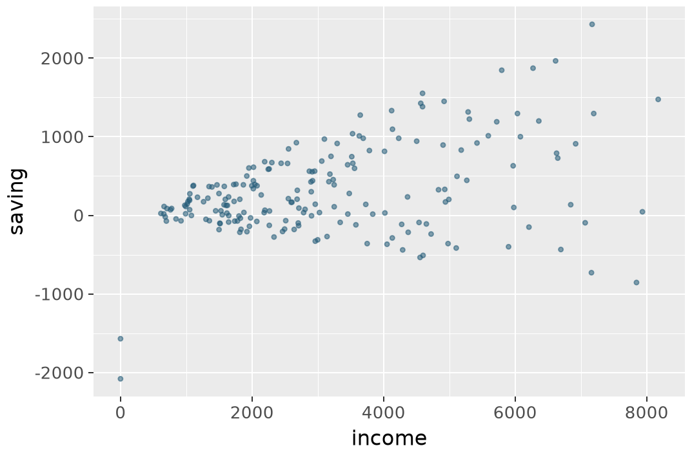{height=480 fig-alt="A constant colour belongs outside aes" style="display:block;margin-inline:auto;"}
:::
::::

::: {.notes}
Clock 09:00–11:00 (2 minutes). The colour is a setting, so it has no legend. Lower alpha makes overlapping observations easier to see.
:::

## A variable colour belongs inside aes

plotnine chooses a colour for each region and creates a legend.

:::: {.columns}
::: {.column width="48%"}
```{.python}
p = (
    pn.ggplot(
        df, pn.aes(
            "income", "saving",
            color="region"
        )
    )
    + pn.geom_point(alpha=0.6)
)
p
```

:::
::: {.column width="52%"}
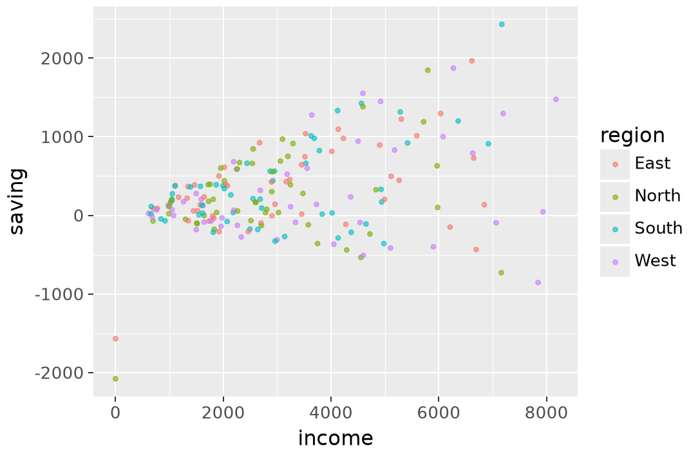{height=480 fig-alt="A variable colour belongs inside aes" style="display:block;margin-inline:auto;"}
:::
::::

::: {.notes}
Clock 11:00–14:00 (3 minutes). Point to the column name region inside aes. Compare with the preceding fixed colour. This is the central mapping-versus-setting distinction.
:::

## A numeric colour uses a gradient

size is numeric. The colour scale now shows household size along a gradient.

:::: {.columns}
::: {.column width="48%"}
```{.python}
p = (
    pn.ggplot(
        df, pn.aes(
            "income", "saving",
            color="size"
        )
    )
    + pn.geom_point(alpha=0.7)
)
p
```

:::
::: {.column width="52%"}
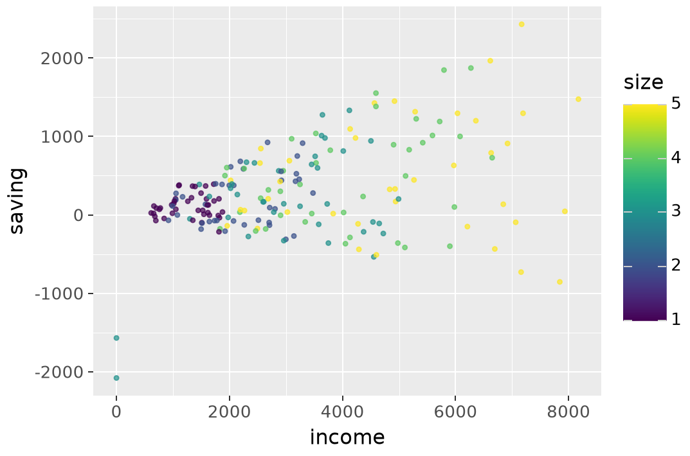{height=480 fig-alt="A numeric colour uses a gradient" style="display:block;margin-inline:auto;"}
:::
::::

::: {.notes}
Clock 14:00–16:00 (2 minutes). A categorical variable receives separate categories; a numeric variable receives a continuous scale by default. Students read the legend rather than guessing what colour means.
:::

## A second layer marks zero saving

The horizontal line marks households whose income equals consumption.

:::: {.columns}
::: {.column width="48%"}
```{.python}
p = (
    base
    + pn.geom_hline(
        yintercept=0, color="#777777"
    )
    + pn.geom_point(alpha=0.55)
)
p
```

:::
::: {.column width="52%"}
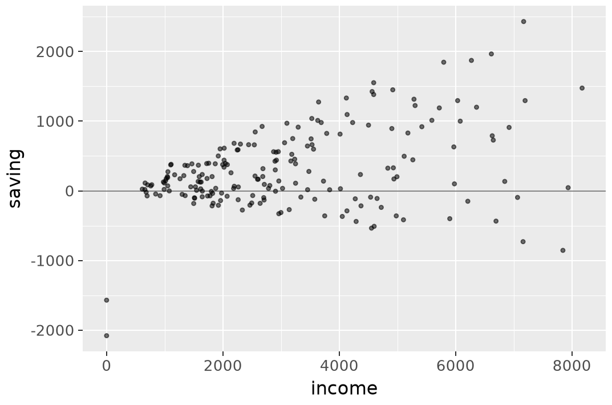{height=480 fig-alt="A second layer marks zero saving" style="display:block;margin-inline:auto;"}
:::
::::

::: {.notes}
Clock 16:00–18:00 (2 minutes). Each plus sign adds a layer. The line's yintercept is a fixed value. Ask which observations lie below it.
:::

## Exercise 1: two-person households

::: {.exercise}
Create the figure in the notebook. Explain why the colour legend appears.
:::

```{.python}
pairs = df.loc[df["size"] == 2].copy()
print("Households to plot:", len(pairs))
# Use pairs as the data.
# Map income to x and saving to y.
# Map region to colour.
# Add points with alpha=0.6 and a line at y=0.
```

::: {.terminal-output .fragment}
```{.text code-line-numbers="false"}
Households to plot: 38
```
:::

::: {.notes}
Clock 18:00–27:00 (9 minutes). Students construct the plot independently, then compare explanations in pairs. Reuse the previous specifications, but change the data argument.
:::

## Exercise 1: worked answer

::: {.answer}
Filtering the data changes which households enter the figure.
:::

:::: {.columns}
::: {.column width="48%"}
```{.python}
p = (
    pn.ggplot(
        pairs, pn.aes(
            "income", "saving",
            color="region"
        )
    )
    + pn.geom_hline(yintercept=0)
    + pn.geom_point(alpha=0.6)
)
p
```

:::
::: {.column width="52%"}
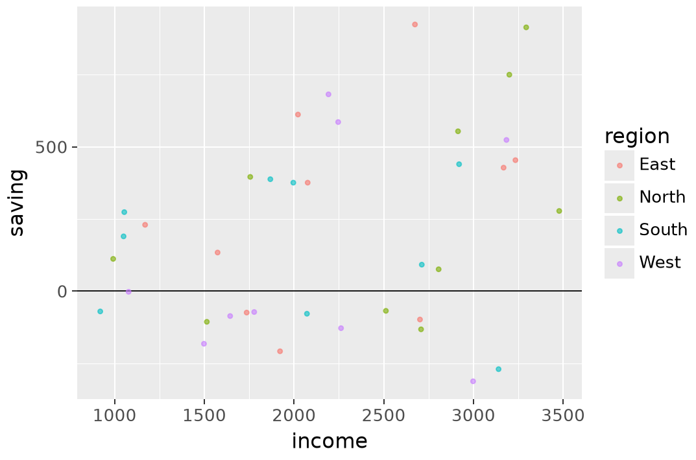{height=480 fig-alt="Exercise 1: worked answer" style="display:block;margin-inline:auto;"}
:::
::::

::: {.notes}
Clock 27:00–30:00 (3 minutes). There are38 complete two-person households. Check the plotted sample against the printed count. Ask which income range the subset covers.
:::

## A histogram counts observations in bins

Each bar counts households in a 250 EUR saving interval.

:::: {.columns}
::: {.column width="48%"}
```{.python}
p = (
    pn.ggplot(df, pn.aes("saving"))
    + pn.geom_histogram(
        binwidth=250,
        fill="#245b78", color="white"
    )
)
p
```

:::
::: {.column width="52%"}
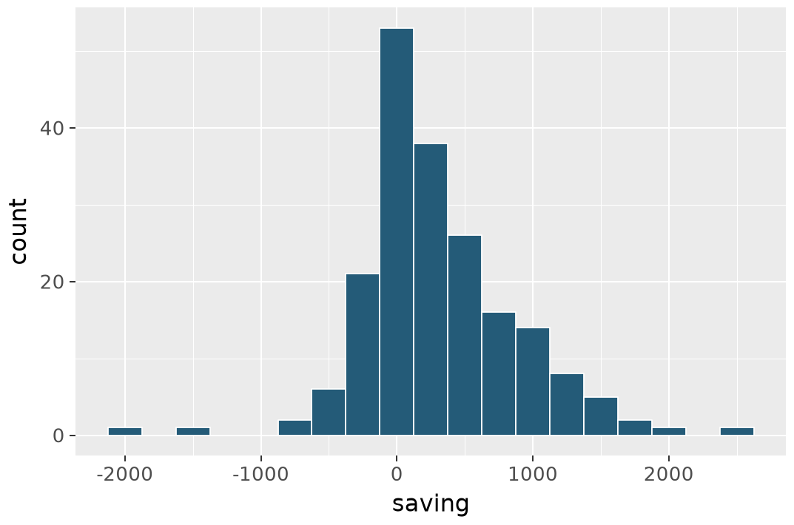{height=480 fig-alt="A histogram counts observations in bins" style="display:block;margin-inline:auto;"}
:::
::::

::: {.notes}
Clock 30:00–33:00 (3 minutes). Only x is mapped. The histogram calculates the y counts. This is the statistical transformation in this graphic. Reference: https://plotnine.org/reference/geom_histogram.html
:::

## Bin width changes the visible pattern

The same 195 households now enter wider, 1000 EUR intervals.

:::: {.columns}
::: {.column width="48%"}
```{.python}
p = (
    pn.ggplot(df, pn.aes("saving"))
    + pn.geom_histogram(
        binwidth=1000,
        fill="#245b78", color="white"
    )
)
p
```

:::
::: {.column width="52%"}
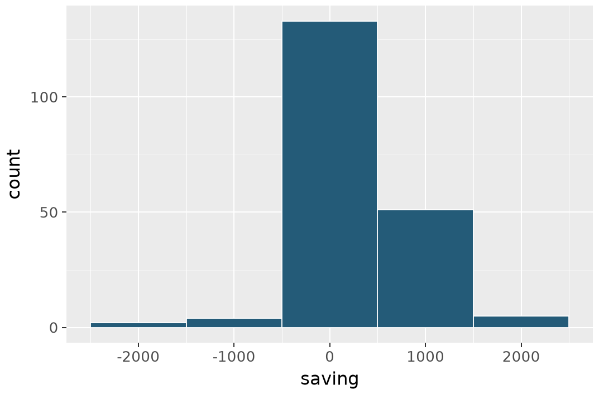{height=480 fig-alt="Bin width changes the visible pattern" style="display:block;margin-inline:auto;"}
:::
::::

::: {.notes}
Clock 33:00–35:00 (2 minutes). Ask which detail disappeared. A bin width is an analytical presentation choice, not a change to the underlying values.
:::

## A bar chart can count raw rows

geom_bar counts rows for each region.

:::: {.columns}
::: {.column width="48%"}
```{.python}
p = (
    pn.ggplot(df, pn.aes("region"))
    + pn.geom_bar(fill="#245b78")
)
p
```

:::
::: {.column width="52%"}
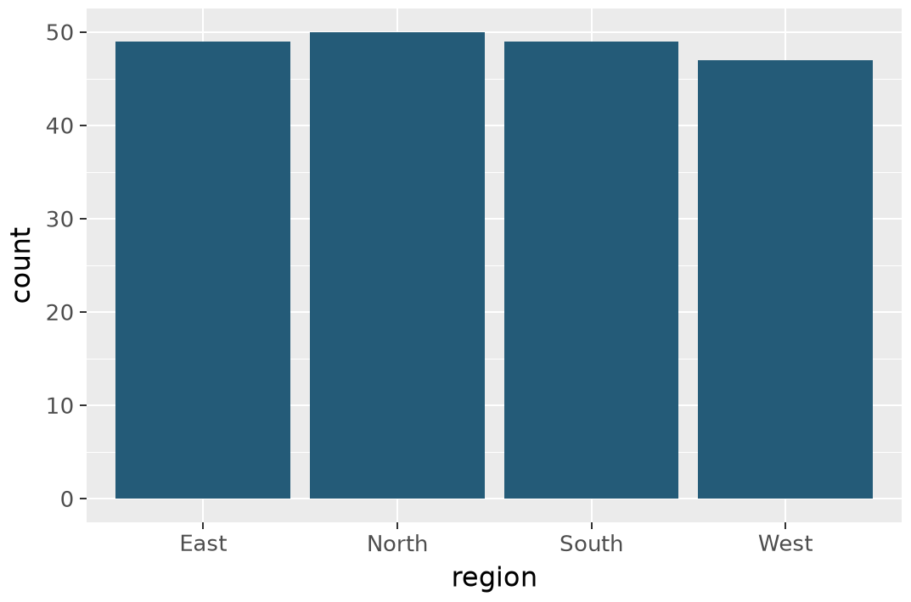{height=480 fig-alt="A bar chart can count raw rows" style="display:block;margin-inline:auto;"}
:::
::::

::: {.notes}
Clock 35:00–37:00 (2 minutes). The bars should add to195. The y variable is computed as a count, as with the histogram. Reference: https://plotnine.org/reference/geom_bar.html
:::

## A table can already contain the heights

The next figure should show mean saving in EUR, using the rightmost column.

```{.python}
summary = df.groupby("region", as_index=False).agg(
    households=("household_id", "size"),
    mean_saving=("saving", "mean"),
)
print(summary.round(1).to_string(index=False))
```

::: {.terminal-output .fragment}
```{.text code-line-numbers="false"}
region  households  mean_saving
  East          49        351.8
 North          50        223.1
 South          49        351.0
  West          47        274.9
```
:::

::: {.notes}
Clock 37:00–39:00 (2 minutes). This recaps the previous lecture. Point to the observation counts and the mean values. The summary has four rows, one per region.
:::

## geom_bar still counts summary rows

These bars are all 1: there is one summary row per region.

:::: {.columns}
::: {.column width="48%"}
```{.python}
p = (
    pn.ggplot(
        summary, pn.aes("region")
    )
    + pn.geom_bar(fill="#245b78")
)
p
```

:::
::: {.column width="52%"}
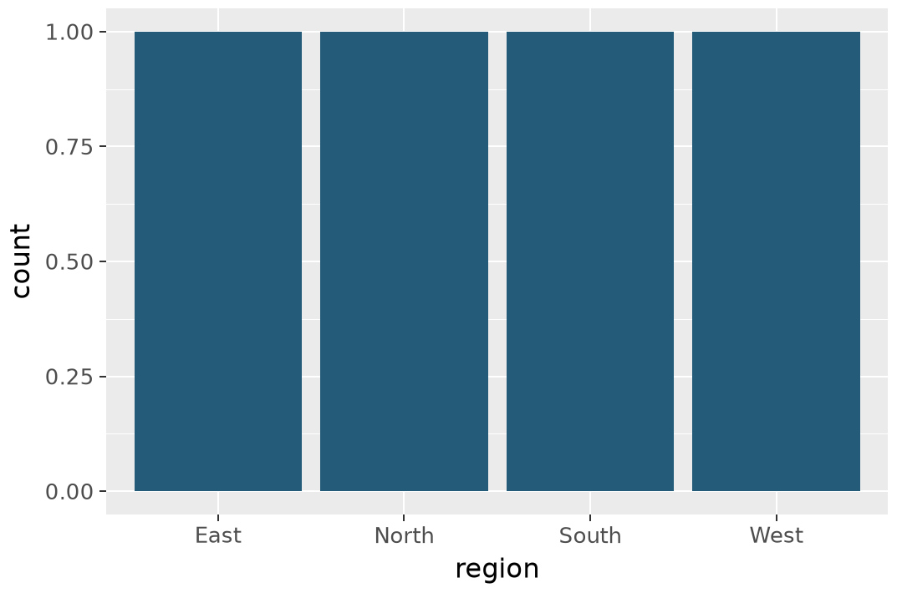{height=480 fig-alt="geom_bar still counts summary rows" style="display:block;margin-inline:auto;"}
:::
::::

::: {.notes}
Clock 39:00–42:00 (3 minutes). Ask why this does not show mean saving. The y axis says count. The plotting function does exactly what its default statistical transformation requests.
:::

## geom_col uses supplied heights

The y mapping supplies the bar heights directly.

:::: {.columns}
::: {.column width="48%"}
```{.python}
p = (
    pn.ggplot(
        summary, pn.aes(
            "region", "mean_saving"
        )
    )
    + pn.geom_col(fill="#245b78")
)
p
```

:::
::: {.column width="52%"}
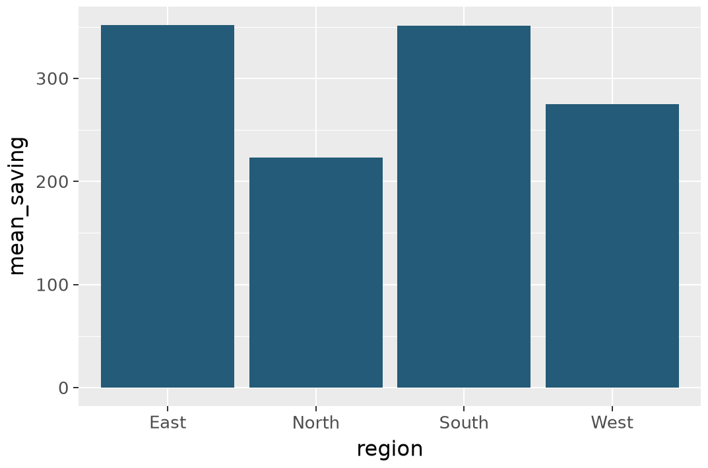{height=480 fig-alt="geom_col uses supplied heights" style="display:block;margin-inline:auto;"}
:::
::::

::: {.notes}
Clock 42:00–45:00 (3 minutes). Compare the northern bar with the summary table. Reference: https://plotnine.org/reference/geom_col.html. Students should explain the choice between geom_bar and geom_col.
:::

## A boxplot compares distributions

The line in each box marks the median saving. The box covers the middle half.

:::: {.columns}
::: {.column width="48%"}
```{.python}
p = (
    pn.ggplot(
        df,
        pn.aes("region", "saving")
    )
    + pn.geom_boxplot(fill="#dbe7ed")
)
p
```

:::
::: {.column width="52%"}
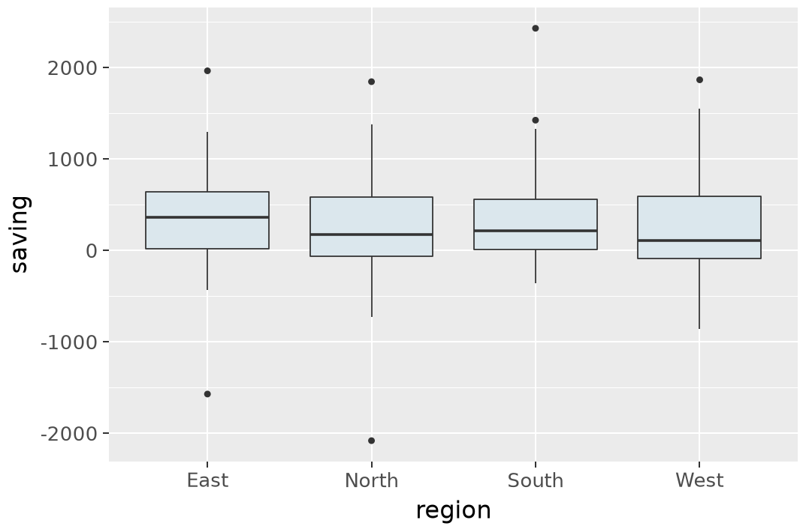{height=480 fig-alt="A boxplot compares distributions" style="display:block;margin-inline:auto;"}
:::
::::

::: {.notes}
Clock 45:00–48:00 (3 minutes). This figure retains within-region variation that a mean bar hides. Whiskers reach the most extreme values within1.5 interquartile ranges; further observations appear as points. They are not confidence intervals. Reference: https://plotnine.org/reference/geom_boxplot.html
:::

## The quartiles behind the boxes

The 25th and 75th percentiles form the box. The 50th percentile is the median.

```{.python}
quartiles = (
    df.groupby("region")["saving"]
    .quantile([0.25, 0.5, 0.75])
    .unstack()
)
print(quartiles.to_string())
```

::: {.terminal-output .fragment}
```{.text code-line-numbers="false"}
         0.25   0.50   0.75
region
East    16.00  366.0  643.0
North  -63.75  171.0  581.0
South    7.00  212.0  562.0
West   -90.50  109.0  592.0
```
:::

::: {.notes}
Clock 48:00–50:00 (2 minutes). Connect one region's printed median to its boxplot line. Students do not need to memorize quantile/unstack syntax; the purpose is to connect a visual summary to numbers.
:::

## Facets repeat a plot for each region

Each panel shows one region. The default axes use common scales.

:::: {.columns}
::: {.column width="48%"}
```{.python}
p = (
    pn.ggplot(
        df,
        pn.aes("income", "saving")
    )
    + pn.geom_point(alpha=0.6)
    + pn.facet_wrap(
        "~region", ncol=2
    )
)
p
```

:::
::: {.column width="52%"}
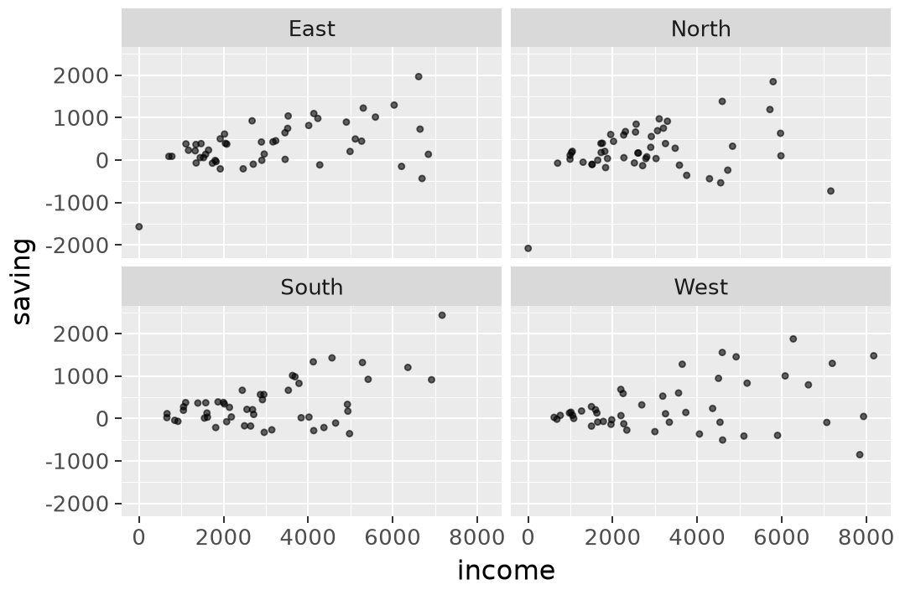{height=480 fig-alt="Facets repeat a plot for each region" style="display:block;margin-inline:auto;"}
:::
::::

::: {.notes}
Clock 50:00–53:00 (3 minutes). The tilde introduces the faceting variable. The same x and y scales support direct comparisons. Reference: https://plotnine.org/reference/facet_wrap.html
:::

## The same facet works with a histogram

Every panel uses the same 250 EUR bin width and the same axis scales.

:::: {.columns}
::: {.column width="48%"}
```{.python}
p = (
    pn.ggplot(df, pn.aes("saving"))
    + pn.geom_histogram(
        binwidth=250,
        fill="#245b78", color="white"
    )
    + pn.facet_wrap(
        "~region", ncol=2
    )
)
p
```

:::
::: {.column width="52%"}
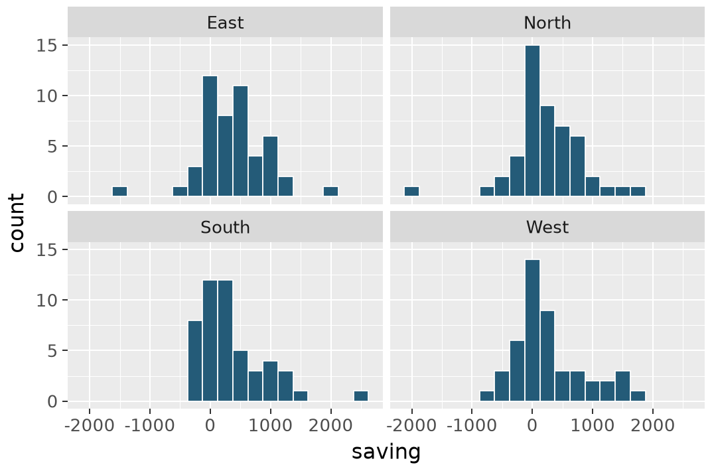{height=480 fig-alt="The same facet works with a histogram" style="display:block;margin-inline:auto;"}
:::
::::

::: {.notes}
Clock 53:00–55:00 (2 minutes). Ask students to distinguish differences in counts, spread, and centre. Common bins make comparisons easier to read.
:::

## Exercise 2: income per person

::: {.exercise}
Use the existing column from Lecture 8. Identify the x and computed y variables.
:::

```{.python}
print(df["income_per_person"].head(3))
# Plot a histogram of income_per_person.
# Use a bin width of 200 EUR.
# Draw one panel per region, in two columns.
# Keep the same bin width and axes across panels.
```

::: {.terminal-output .fragment}
```{.text code-line-numbers="false"}
0    1510.0
1     998.0
2    1338.0
Name: income_per_person, dtype: float64
```
:::

::: {.notes}
Clock 55:00–64:00 (9 minutes). Students construct the plot independently, then interpret one regional panel together. The response should name y as count, not income.
:::

## Exercise 2: worked answer

::: {.answer}
The data transformation happened in pandas. The histogram counts the transformed values.
:::

:::: {.columns}
::: {.column width="48%"}
```{.python}
mapping = pn.aes(
    "income_per_person")
p = pn.ggplot(df, mapping)
p = p + pn.geom_histogram(
    binwidth=200,
    fill="#245b78", color="white")
p = p + pn.facet_wrap(
    "~region", ncol=2)
p
```

:::
::: {.column width="52%"}
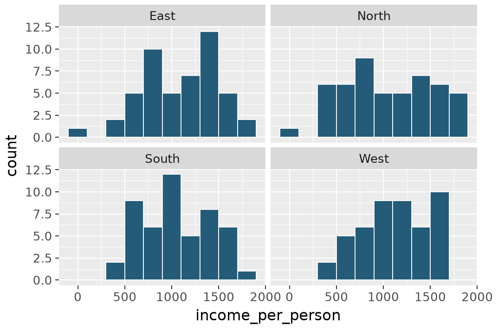{height=480 fig-alt="Exercise 2: worked answer" style="display:block;margin-inline:auto;"}
:::
::::

::: {.notes}
Clock 64:00–67:00 (3 minutes). Check the axes and the count interpretation. Household income per person is not a population-weighted distribution of individual incomes.
:::

## Saving shares as percentages

Two zero-income households have undefined saving shares. This figure uses the other 193.

```{.python}
rates = df.dropna(subset=["saving_share"]).copy()
rates["saving_pct"] = 100 * rates["saving_share"]
print("Plotted households:", len(rates))
print(rates[["saving_share", "saving_pct"]].head(3).round(2)
      .to_string(index=False))
```

::: {.terminal-output .fragment}
```{.text code-line-numbers="false"}
Plotted households: 193
 saving_share  saving_pct
        -0.07       -6.62
         0.19       18.84
         0.20       20.28
```
:::

::: {.notes}
Clock 67:00–69:00 (2 minutes). Keep the amount sample195 distinct from this share sample193. Multiplying by100 changes the display units from a fraction to percent.
:::

## A new mapping uses the new units

The y values and the axis label now agree about percentages.

:::: {.columns}
::: {.column width="48%"}
```{.python}
mapping = pn.aes(
    "income_per_person",
    "saving_pct", color="region")
p = pn.ggplot(rates, mapping)
p = p + pn.geom_point(alpha=0.6)
p = p + pn.labs(
    y="Saving (% of income)")
p
```

:::
::: {.column width="52%"}
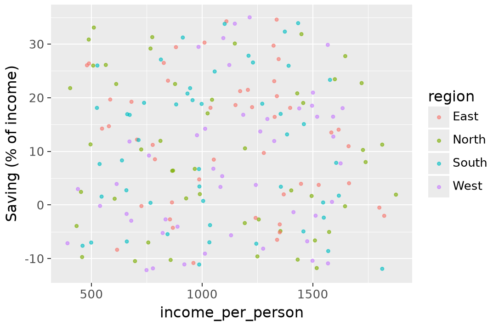{height=480 fig-alt="A new mapping uses the new units" style="display:block;margin-inline:auto;"}
:::
::::

::: {.notes}
Clock 69:00–71:00 (2 minutes). Ask what would happen if the percentage label changed but the data stayed as fractional shares. Changing the axis title alone does not rescale the plotted values or tick labels.
:::

## A categorical household size

Converting size to a category creates one distribution per household-size group.

:::: {.columns}
::: {.column width="48%"}
```{.python}
df["size_group"] = (
    df["size"].astype("category")
)
p = (
    pn.ggplot(
        df, pn.aes(
            "size_group", "saving"
        )
    )
    + pn.geom_boxplot()
)
p
```

:::
::: {.column width="52%"}
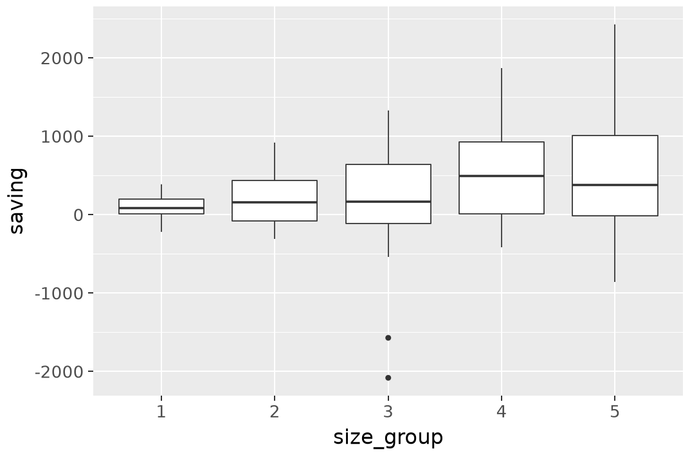{height=480 fig-alt="A categorical household size" style="display:block;margin-inline:auto;"}
:::
::::

::: {.notes}
Clock 71:00–73:00 (2 minutes). Contrast a discrete grouping variable with the continuous colour scale earlier. There is no weighting by household size in this graphic.
:::

## Mappings can belong to one layer

The point layer maps colour to region. The zero-saving line keeps a constant appearance.

:::: {.columns}
::: {.column width="48%"}
```{.python}
p = (
    pn.ggplot(
        df,
        pn.aes("income", "saving")
    )
    + pn.geom_hline(yintercept=0)
    + pn.geom_point(
        pn.aes(color="region"),
        alpha=0.6
    )
)
p
```

:::
::: {.column width="52%"}
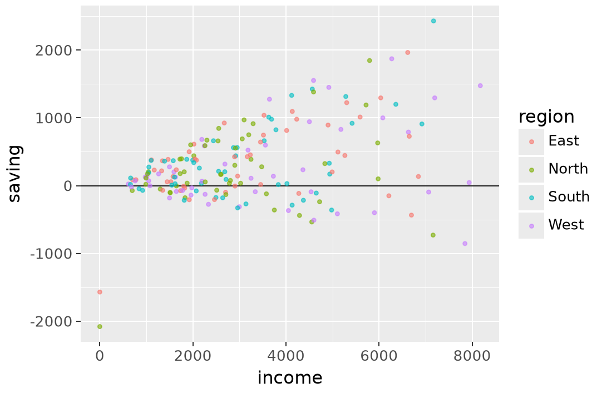{height=480 fig-alt="Mappings can belong to one layer" style="display:block;margin-inline:auto;"}
:::
::::

::: {.notes}
Clock 73:00–75:00 (2 minutes). End by reading the full specification aloud: data, x/y mapping, a reference layer, a point layer with its own colour mapping. Students can now build and explain several complete graphics.
:::
