## The same 195 households

```{.python}
from pathlib import Path
import pandas as pd
import plotnine as pn
from lesson_data import load_households
df = load_households()
print("Households:", len(df))
print("Negative saving:", (df["saving"] < 0).sum())
```

::: {.terminal-output .fragment}
```{.text code-line-numbers="false"}
Households: 195
Negative saving: 57
```
:::

Open 05_design.ipynb. Money amounts are EUR per month.

::: {.notes}
Clock 01:00–04:00 (3 minutes). Reconnect to the clean sample from Lecture 8. All plot comparisons use these same rows unless a later example explicitly filters them.
:::

## The default scatterplot

:::: {.columns}

::: {.column width="53%"}

```{.python}
base = pn.ggplot(df,
    pn.aes("income", "saving"))
default = base + pn.geom_point()
default
```

:::

::: {.column width="47%"}

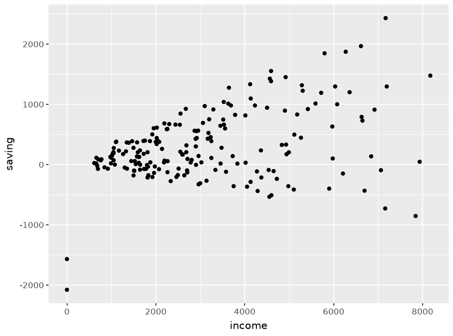{width=640 height=475 fig-alt="The default scatterplot; synthetic household data."}

:::

::::

Which units belong on each axis? Which dots overlap?

::: {.notes}
Clock 04:00–06:00 (2 minutes). Ask for two specific problems before editing. This is a valid exploratory plot with default labels.
:::

## Axis labels and a useful title

:::: {.columns}

::: {.column width="53%"}

```{.python}
labelled = base + pn.labs(
    title="Household saving and income",
    x="Monthly income (EUR)",
    y="Monthly saving (EUR)",
)
p = labelled + pn.geom_point()
p
```

:::

::: {.column width="47%"}

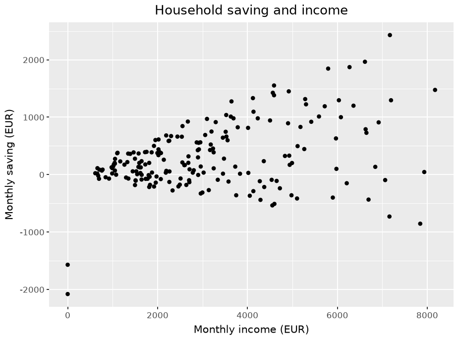{width=640 height=475 fig-alt="Axis labels and a useful title; synthetic household data."}

:::

::::

The variable names become labels the reader can interpret.

::: {.notes}
Clock 06:00–08:00 (2 minutes). Explain labs as the annotation layer. Data and mappings stay the same. Reference: https://plotnine.org/reference/labs.html
:::

## Point size and transparency

:::: {.columns}

::: {.column width="53%"}

```{.python}
points = labelled + pn.geom_point(
    color="#286482",
    alpha=0.55,
    size=1.8,
)
points
```

:::

::: {.column width="47%"}

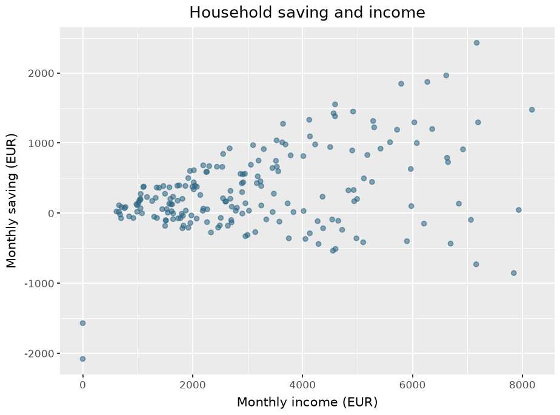{width=640 height=475 fig-alt="Point size and transparency; synthetic household data."}

:::

::::

alpha = 0.55 makes overlapping observations darker.

::: {.notes}
Clock 08:00–10:00 (2 minutes). Point out the dense low-income area. Ask students to try alpha=1 and size=4 in the notebook and compare legibility.
:::

## The zero-saving reference

:::: {.columns}

::: {.column width="53%"}

```{.python}
zero = points + pn.geom_hline(
    yintercept=0,
    color="#777777",
    size=0.5,
)
zero
```

:::

::: {.column width="47%"}

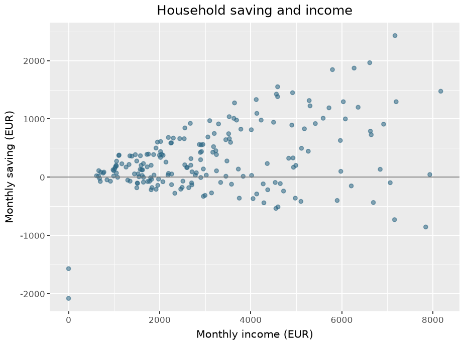{width=640 height=475 fig-alt="The zero-saving reference; synthetic household data."}

:::

::::

Dots below the line have consumption greater than income.

::: {.notes}
Clock 10:00–12:00 (2 minutes). The line marks an economically meaningful reference. It is not a regression or an estimated relationship.
:::

## A quieter background

:::: {.columns}

::: {.column width="53%"}

```{.python}
clean = (
    zero
    + pn.theme_minimal(base_size=15)
    + pn.theme(
        panel_grid_minor=(
            pn.element_blank())
    )
)
clean
```

:::

::: {.column width="47%"}

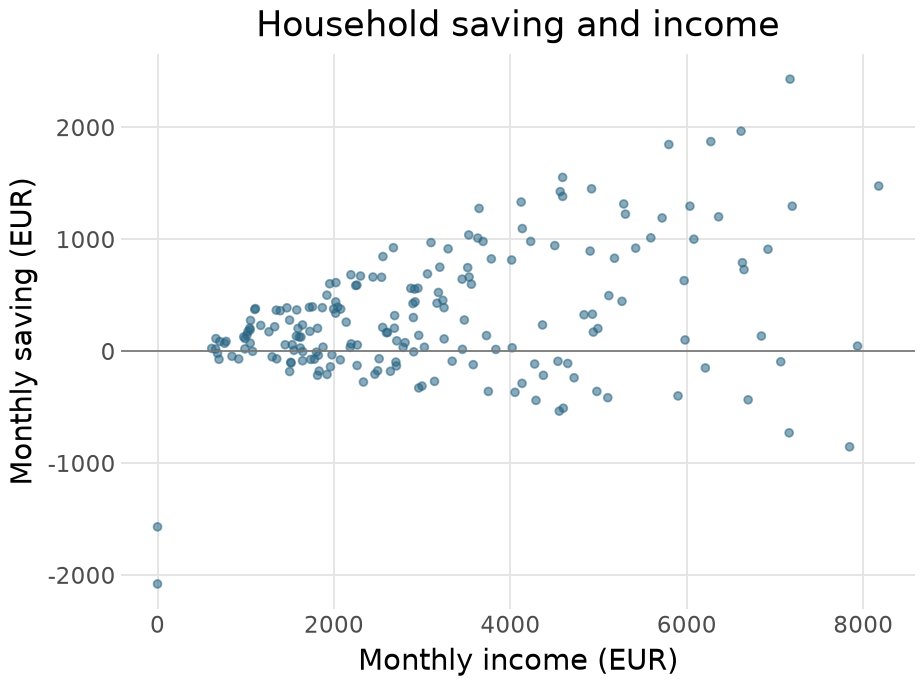{width=640 height=475 fig-alt="A quieter background; synthetic household data."}

:::

::::

Minor gridlines disappear. Major gridlines still help compare amounts.

::: {.notes}
Clock 12:00–14:00 (2 minutes). Show that theme modifies appearance without changing the data. Reference: https://plotnine.org/reference/theme_minimal.html
:::

## The caption identifies the sample

:::: {.columns}

::: {.column width="53%"}

```{.python}
finished = clean + pn.labs(
    caption=(
        "Synthetic classroom data"
        f" | n = {len(df)} households"
    )
)
finished
```

:::

::: {.column width="47%"}

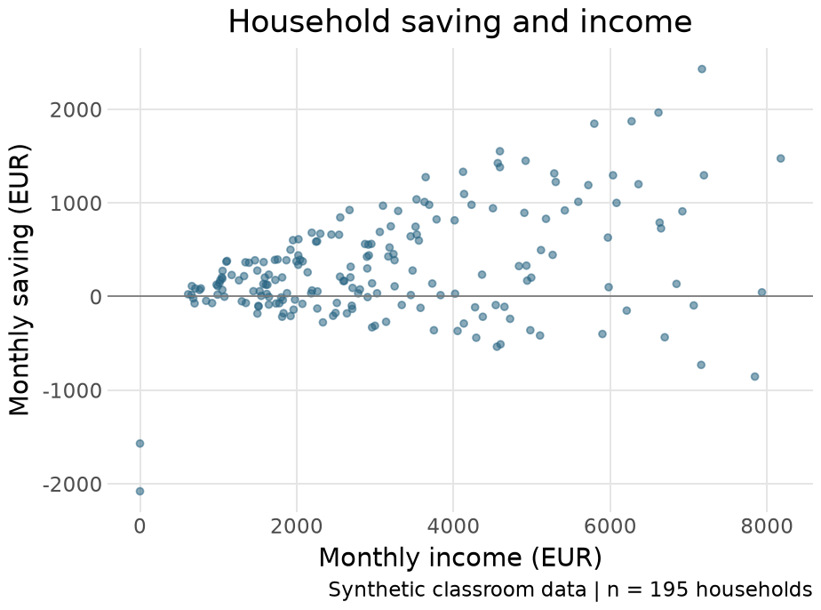{width=640 height=475 fig-alt="The caption identifies the sample; synthetic household data."}

:::

::::

195 observations have usable income and consumption.

::: {.notes}
Clock 14:00–16:00 (2 minutes). Ask where 195 came from. The caption is short enough to read beside the plot. No claim about actual regional populations is supported.
:::

## Exercise 1 · Consumption and income

::: {.exercise}
Build a scatterplot of consumption against income. Use pn.geom_abline(slope=1, intercept=0). What does a dot above the line mean?
:::

```{.python}
# Use the same df.
# Put income on x and consumption on y.
# Add a 45-degree reference line.
# Use labels, alpha, a theme, and a caption.
```

::: {.notes}
Clock 16:00–22:00 (6 minutes). Four minutes to build the plot, two to compare and interpret. Students should adapt the previous code rather than copy the worked answer.
:::

## Worked answer · Consumption and income

:::: {.columns}

::: {.column width="53%"}

```{.python}
spending = (
    pn.ggplot(df,
        pn.aes("income", "consumption"))
    + pn.geom_abline(slope=1, intercept=0)
    + pn.geom_point(alpha=0.5,
        color="#286482")
    + pn.labs(x="Monthly income (EUR)",
        y="Monthly consumption (EUR)",
        caption=("Synthetic households"
            " | n=195"))
    + pn.theme_minimal(base_size=15)
)
spending
```

:::

::: {.column width="47%"}

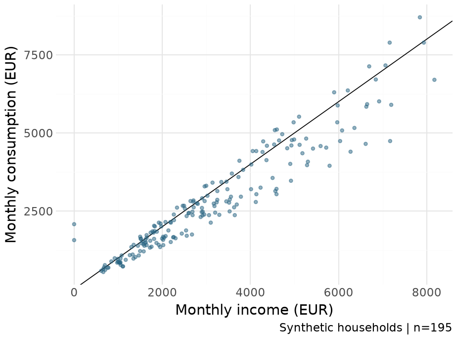{width=640 height=475 fig-alt="Worked answer · Consumption and income; synthetic household data."}

:::

::::

Above the diagonal, consumption exceeds income.

::: {.notes}
Clock 22:00–24:00 (2 minutes). The two axes have the same money units. A 45-degree numerical reference relates equal x and y values. The physical angle depends on the plot's aspect ratio.
:::

## Colour identifies a variable

:::: {.columns}

::: {.column width="53%"}

```{.python}
by_region = (
    pn.ggplot(df,
        pn.aes("income", "saving",
               color="region"))
    + pn.geom_point(alpha=0.65)
    + pn.labs(x="Income (EUR)",
        y="Saving (EUR)", color="Region")
    + pn.theme_minimal(base_size=15)
)
by_region
```

:::

::: {.column width="47%"}

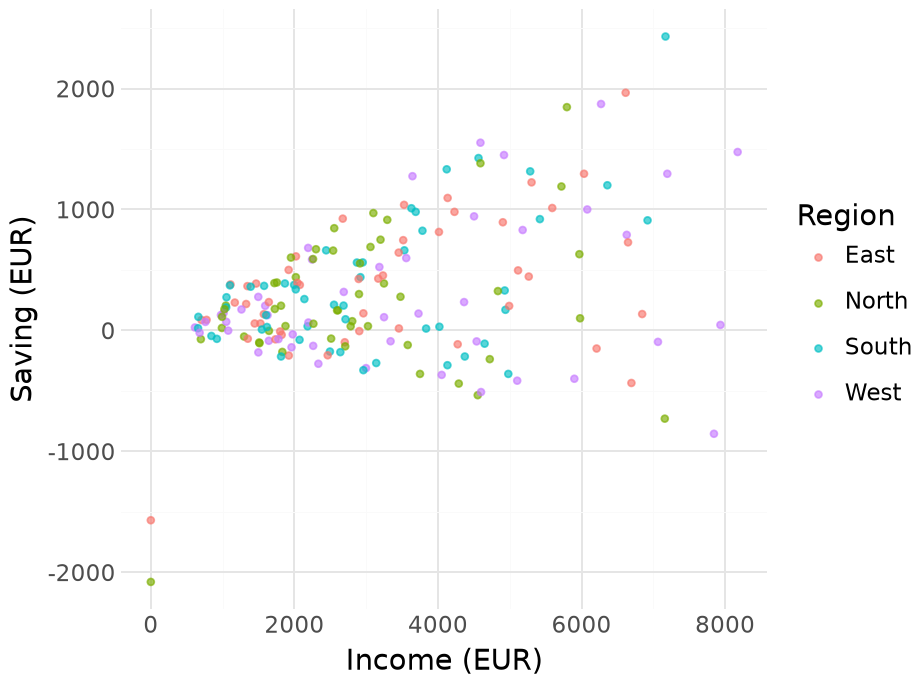{width=640 height=475 fig-alt="Colour identifies a variable; synthetic household data."}

:::

::::

The region column creates the groups and legend.

::: {.notes}
Clock 24:00–26:00 (2 minutes). Reconnect to aes in Lecture 10. A colour outside aes would give every observation the same colour.
:::

## An explicit four-colour palette

:::: {.columns}

::: {.column width="53%"}

```{.python}
palette = {
    "East": "#0072B2",
    "North": "#D55E00",
    "South": "#009E73",
    "West": "#CC79A7",
}
coloured = (
    by_region
    + pn.scale_color_manual(
        values=palette)
)
coloured
```

:::

::: {.column width="47%"}

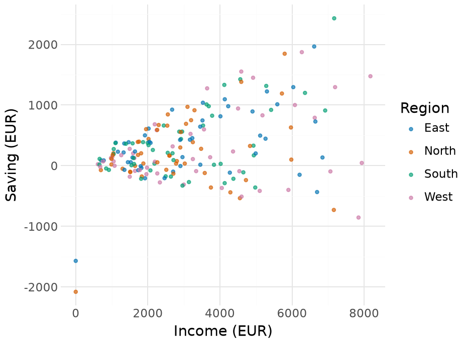{width=640 height=475 fig-alt="An explicit four-colour palette; synthetic household data."}

:::

::::

Use region names to keep colours consistent across figures.

::: {.notes}
Clock 26:00–28:00 (2 minutes). This uses four colours from the colourblind-friendly Okabe-Ito palette. Labels and facets should also identify groups. Reference: https://plotnine.org/reference/scale_color_manual.html
:::

## Common axes across panels

:::: {.columns}

::: {.column width="53%"}

```{.python}
panels = (
    coloured
    + pn.facet_wrap("region", ncol=2)
    + pn.theme(legend_position="none")
)
panels
```

:::

::: {.column width="47%"}

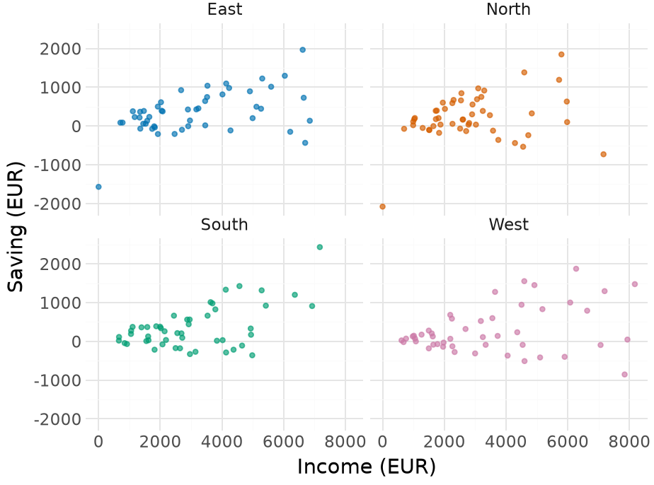{width=640 height=475 fig-alt="Common axes across panels; synthetic household data."}

:::

::::

Each panel uses the same income and saving scales.

::: {.notes}
Clock 28:00–30:00 (2 minutes). Ask students to locate saving=1000 in two panels. Common scales support comparisons of levels as well as shapes.
:::

## The numbers behind a comparison

```{.python}
summary = df.groupby("region", as_index=False).agg(
    households=("household_id", "size"),
    mean_saving=("saving", "mean"),
)
print(summary.round(1).to_string(index=False))
```

::: {.terminal-output .fragment}
```{.text code-line-numbers="false"}
region  households  mean_saving
  East          49        351.8
 North          50        223.1
 South          49        351.0
  West          47        274.9
```
:::

A bar height will represent mean monthly saving.

::: {.notes}
Clock 30:00–32:00 (2 minutes). The plot's four observations are now regional summary rows. These are descriptive means for synthetic households.
:::

## Alphabetical category order

:::: {.columns}

::: {.column width="53%"}

```{.python}
bars = (
    pn.ggplot(summary,
        pn.aes("region", "mean_saving"))
    + pn.geom_col(fill="#286482")
    + pn.labs(x="Region",
        y="Mean monthly saving (EUR)")
    + pn.theme_minimal(base_size=15)
)
bars
```

:::

::: {.column width="47%"}

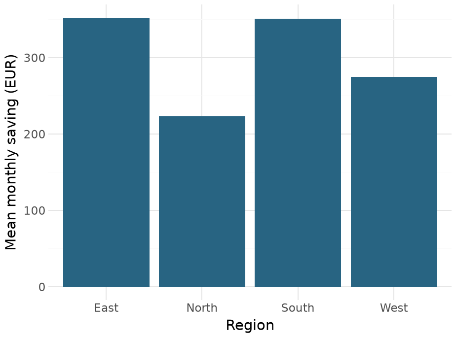{width=640 height=475 fig-alt="Alphabetical category order; synthetic household data."}

:::

::::

Alphabetical order gives no immediate ranking by saving.

::: {.notes}
Clock 32:00–34:00 (2 minutes). Ask which two means are closest. Preserve zero as the reference for bar lengths.
:::

## Ordering is part of the data

```{.python}
order = summary.sort_values(
    "mean_saving"
)["region"].tolist()
ordered = summary.copy()
ordered["region"] = pd.Categorical(
    ordered["region"], categories=order,
    ordered=True,
)
ordered["value"] = ordered["mean_saving"].round(1)
print(order)
```

::: {.terminal-output .fragment}
```{.text code-line-numbers="false"}
['North', 'West', 'South', 'East']
```
:::

The categorical order controls the discrete axis.

::: {.notes}
Clock 34:00–37:00 (3 minutes). Sorting the rows alone is not sufficient to declare the axis order. Here low-to-high order will place the largest value at the top after coordinate flipping.
:::

## Horizontal bars and direct labels

:::: {.columns}

::: {.column width="53%"}

```{.python}
ranked = (
    pn.ggplot(ordered,
        pn.aes("region", "mean_saving"))
    + pn.geom_col(fill="#286482")
    + pn.geom_text(pn.aes(label="value"),
        ha="left", nudge_y=8, size=11)
    + pn.expand_limits(y=430)
    + pn.coord_flip()
    + pn.labs(x="",
        y="Mean saving (EUR/month)")
    + pn.theme_minimal(base_size=15)
)
ranked
```

:::

::: {.column width="47%"}

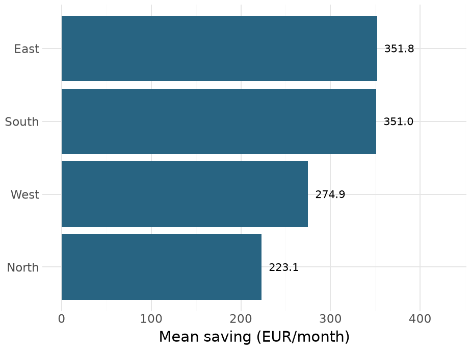{width=640 height=475 fig-alt="Horizontal bars and direct labels; synthetic household data."}

:::

::::

Read exact values without estimating the end of each bar.

::: {.notes}
Clock 37:00–39:00 (2 minutes). Labels are a useful exception to relying only on an axis. Explain that coordinates flip after mapping. Use the notebook to try a dot chart as an extension.
:::

## A zoom excludes some values from view

```{.python}
inside = df["saving"].between(0, 1000)
print("All households:", len(df))
print("Within 0 to 1000:", inside.sum())
print("Median, all:", df["saving"].median())
print("Median, selected:", df.loc[
    inside, "saving"].median())
```

::: {.terminal-output .fragment}
```{.text code-line-numbers="false"}
All households: 195
Within 0 to 1000: 117
Median, all: 177.0
Median, selected: 325.0
```
:::

The selected subset has a different median.

::: {.notes}
Clock 39:00–41:00 (2 minutes). Make the effect concrete before introducing scale and coordinate limits. Both negative saving and high positive saving lie outside the selected range.
:::

## Scale limits change boxplot statistics

:::: {.columns}

::: {.column width="53%"}

```{.python}
box = (
    pn.ggplot(df,
        pn.aes("region", "saving"))
    + pn.geom_boxplot(fill="#A9CBDC")
    + pn.theme_minimal(base_size=15)
)
limited = box + pn.scale_y_continuous(
    limits=(0, 1000)
)
limited
```

:::

::: {.column width="47%"}

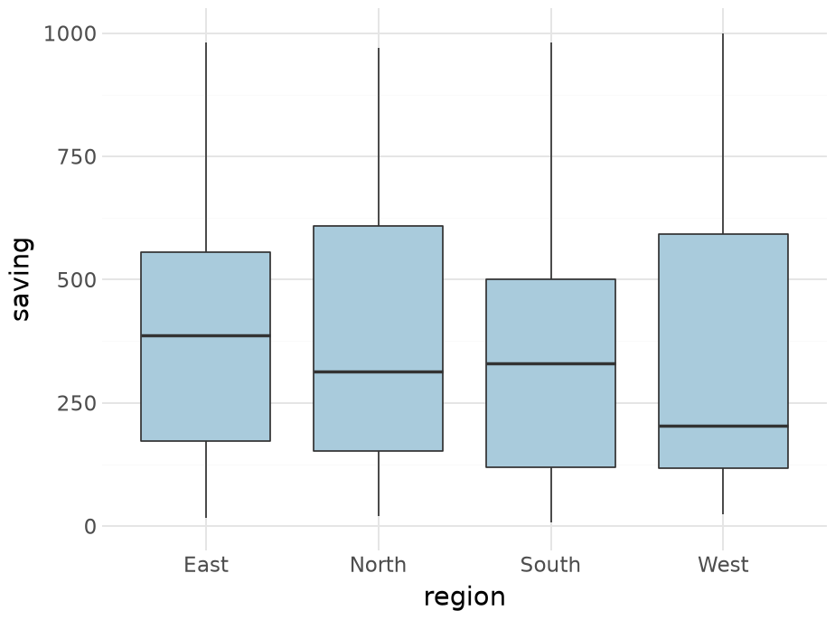{width=640 height=475 fig-alt="Scale limits change boxplot statistics; synthetic household data."}

:::

::::

Scale limits remove observations before the boxplot calculates quartiles.

::: {.notes}
Clock 41:00–44:00 (3 minutes). Expect a removal warning when drawing. The median line can move because the boxplot now uses a restricted sample. Reference: https://plotnine.org/reference/scale_y_continuous.html
:::

## Coordinate limits zoom the full boxplot

:::: {.columns}

::: {.column width="53%"}

```{.python}
zoomed = box + pn.coord_cartesian(
    ylim=(0, 1000)
)
zoomed
```

:::

::: {.column width="47%"}

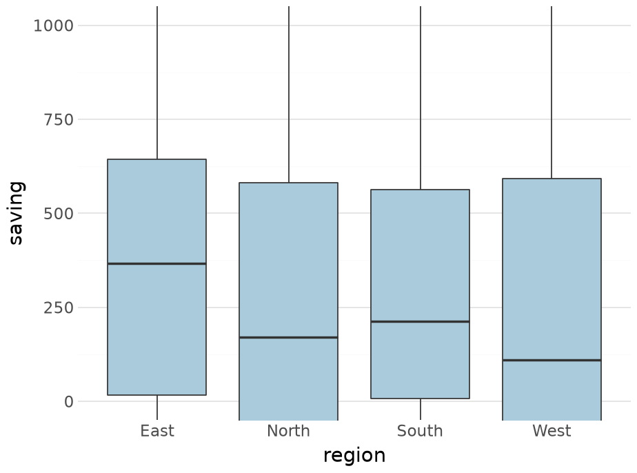{width=640 height=475 fig-alt="Coordinate limits zoom the full boxplot; synthetic household data."}

:::

::::

Each region’s quartiles use its full sample. Only the display window changes.

::: {.notes}
Clock 44:00–47:00 (3 minutes). Compare the median lines with the previous slide. Coordinate zoom is usually the appropriate display-only edit. Reference: https://plotnine.org/reference/coord_cartesian.html
:::

## Exercise 2 · Rank median income

::: {.exercise}
Create a ranked comparison of median monthly income per person. Explain why it answers a different question from mean household saving.
:::

```{.python}
# Calculate median income per person by region.
# Order the categories by that median.
# Make a horizontal bar or point chart.
# Label the units and display each value.
```

::: {.notes}
Clock 47:00–53:00 (6 minutes). Four minutes to work, two to compare. Students may use geom_point instead of geom_col. Ask why dividing household income by size matters.
:::

## Worked answer · The median table

```{.python}
medians = df.groupby("region", as_index=False).agg(
    median_income=("income_per_person", "median")
)
order = medians.sort_values(
    "median_income")["region"].tolist()
medians["region"] = pd.Categorical(
    medians["region"], categories=order,
    ordered=True,
)
medians["value"] = medians["median_income"].round(1)
print(medians.round(1).to_string(index=False))
```

::: {.terminal-output .fragment}
```{.text code-line-numbers="false"}
region  median_income  value
  East         1151.0 1151.0
 North         1007.5 1007.5
 South          998.0  998.0
  West         1131.0 1131.0
```
:::

Each region contributes one median income per person.

::: {.notes}
Clock 53:00–55:00 (2 minutes). The table makes the intended ranking explicit before plotting. Changing the statistic and denominator changes the research question.
:::

## Worked answer · The ranked plot

:::: {.columns}

::: {.column width="53%"}

```{.python}
median_plot = (
    pn.ggplot(medians,
        pn.aes("region", "median_income"))
    + pn.geom_col(fill="#0072B2")
    + pn.geom_text(pn.aes(label="value"),
        ha="left", nudge_y=15, size=11)
    + pn.expand_limits(y=1200)
    + pn.coord_flip()
    + pn.labs(x="", y=("Median income"
        " (EUR/person/month)"))
    + pn.theme_minimal(base_size=15)
)
median_plot
```

:::

::: {.column width="47%"}

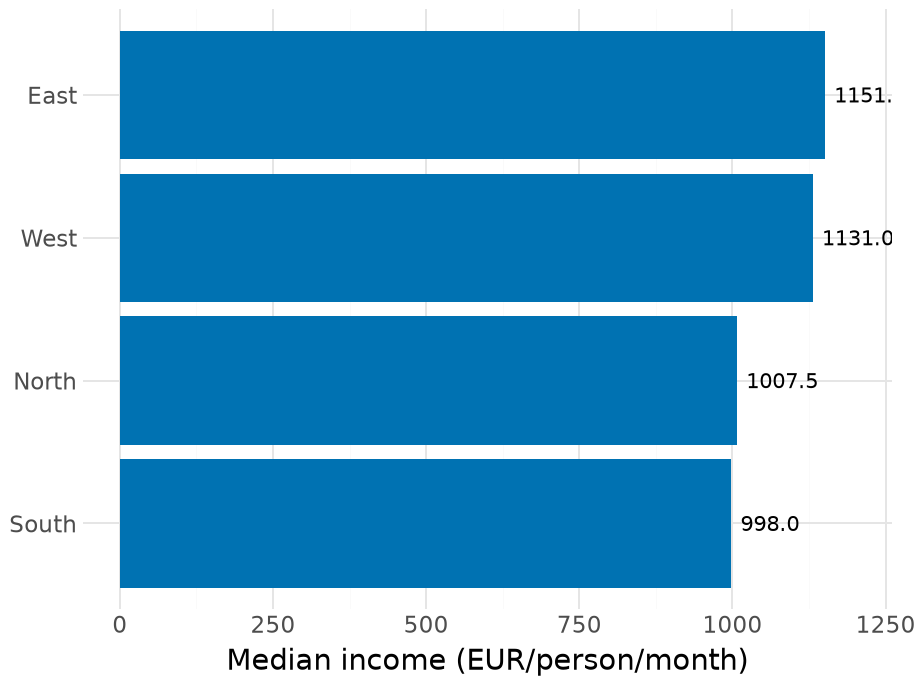{width=640 height=475 fig-alt="Worked answer · The ranked plot; synthetic household data."}

:::

::::

Income per person and saving measure different aspects of a household budget.

::: {.notes}
Clock 55:00–57:00 (2 minutes). Ask students to report the actual order from the displayed figure rather than presume it matches mean saving. The same sample supports distinct descriptive comparisons.
:::

## PNG for slides, PDF for print

```{.python}
output = Path("outputs")
output.mkdir(exist_ok=True)
median_plot.save(
    output / "median-income.png",
    width=9, height=5, dpi=200, verbose=False,
)
median_plot.save(
    output / "median-income.pdf",
    width=9, height=5, verbose=False,
)
print((output / "median-income.png").is_file())
```

::: {.terminal-output .fragment}
```{.text code-line-numbers="false"}
True
```
:::

The plot code stays editable. The exported files record the chosen size.

::: {.notes}
Clock 57:00–60:00 (3 minutes). 9 by 5 inches at 200 dpi gives an 1800 by 1000 pixel PNG. PDF preserves vector geometry. Inspect the exported figure at its intended use size.
:::
