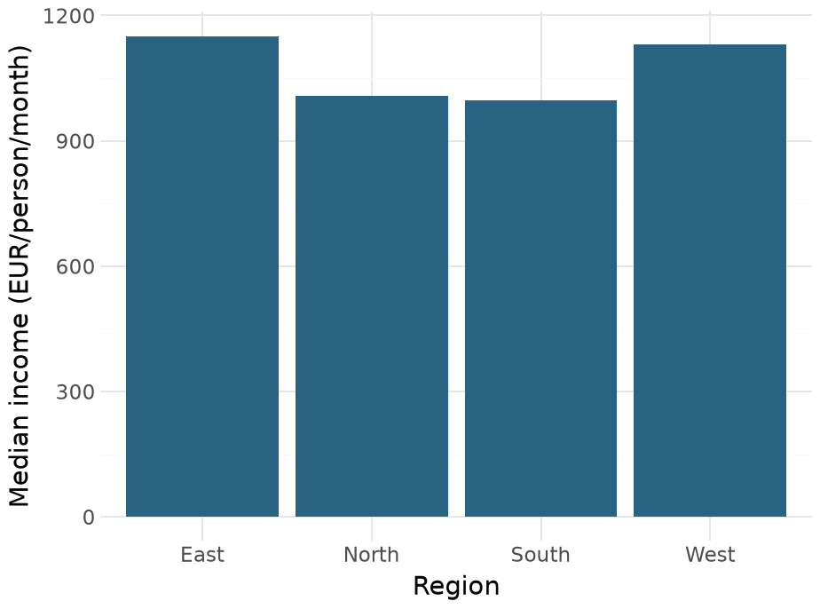
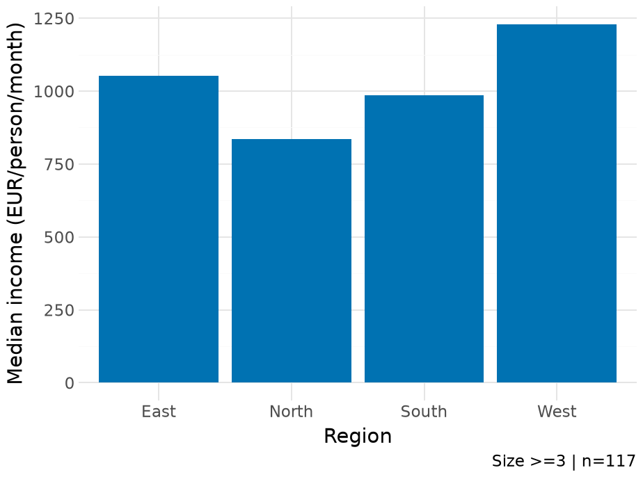

## The data behind the table

```{.python}
from pathlib import Path
import math
import pandas as pd
import plotnine as pn
from IPython.display import HTML, display
from lesson_data import load_households
df = load_households()
output = Path("outputs")
output.mkdir(exist_ok=True)
print(len(df), df["saving_share"].count())
```

::: {.terminal-output .fragment}
```{.text code-line-numbers="false"}
195 193
```
:::

195 households have saving amounts. 193 have a defined saving share.

::: {.notes}
Clock 01:00–03:00 (2 minutes). Open 06_tables.ipynb from codes/day-2. The loader reuses the cleaning and checked join already taught. Keep the table's row unit distinct from its household sample.
:::

## One variable, several statistics

```{.python}
saving = pd.Series([0, 100, 200, 300, 1400])
print(saving.agg(["count", "mean", "median"]))
```

::: {.terminal-output .fragment}
```{.text code-line-numbers="false"}
count       5.0
mean      400.0
median    200.0
dtype: float64
```
:::

The mean is 400 EUR. The median is 200 EUR.

::: {.notes}
Clock 03:00–05:00 (2 minutes). Ask for both hand calculations before revealing output. The high final value pulls the mean upward. The question determines the useful statistic.
:::

## The regional table

```{.python}
summary = df.groupby("region", as_index=False).agg(
    households=("household_id", "size"),
    mean_saving=("saving", "mean"),
    median_saving=("saving", "median"),
)
print(summary.round(1).to_string(index=False))
```

::: {.terminal-output .fragment}
```{.text code-line-numbers="false"}
region  households  mean_saving  median_saving
  East          49        351.8          366.0
 North          50        223.1          171.0
 South          49        351.0          212.0
  West          47        274.9          109.0
```
:::

Mean and median describe different features of the same saving distribution.

::: {.notes}
Clock 05:00–07:00 (2 minutes). The rows now represent regions. Counts keep each monetary statistic attached to its sample. Reference: https://pandas.pydata.org/docs/user_guide/groupby.html
:::

## The denominator next to the statistic

```{.python}
shares = df.groupby("region", as_index=False).agg(
    households=("household_id", "size"),
    defined_shares=("saving_share", "count"),
    mean_share=("saving_share", "mean"),
)
print(shares.round(3).to_string(index=False))
```

::: {.terminal-output .fragment}
```{.text code-line-numbers="false"}
region  households  defined_shares  mean_share
  East          49              48       0.123
 North          50              49       0.095
 South          49              49       0.106
  West          47              47       0.071
```
:::

size counts rows. count counts non-missing saving shares.

::: {.notes}
Clock 07:00–09:00 (2 minutes). Ask why North and East have one fewer defined share. Do not replace an undefined share with zero to make the counts match.
:::

## Rounding a displayed copy

```{.python}
precision = summary[["region", "mean_saving"]].copy()
precision["display"] = precision["mean_saving"].round(1)
print(precision.to_string(index=False))
```

::: {.terminal-output .fragment}
```{.text code-line-numbers="false"}
region  mean_saving  display
  East   351.836735    351.8
 North   223.120000    223.1
 South   351.040816    351.0
  West   274.914894    274.9
```
:::

The display column rounds to one decimal. mean_saving retains the original values.

::: {.notes}
Clock 09:00–11:00 (2 minutes). Compare stored and displayed values for West. The formatted table can use fewer decimals without altering the underlying calculation.
:::

## Fractions and percent labels

```{.python}
share = 0.1234
print(f"{share:.3f}")
print(f"{share:.1%}")
print(f"{100 * share:.1f}%")
```

::: {.terminal-output .fragment}
```{.text code-line-numbers="false"}
0.123
12.3%
12.3%
```
:::

The final two lines both display 12.3%.

::: {.notes}
Clock 11:00–13:00 (2 minutes). A percent format multiplies by 100 during formatting. Ask students to predict what the mistaken expression f'{100 * share:.1%}' would show before trying it.
:::

## A table with readable headings

```{.python}
view = summary.rename(columns={
    "region": "Region",
    "households": "Households",
    "mean_saving": "Mean saving (EUR)",
    "median_saving": "Median saving (EUR)",
})
print(view.round(1).to_string(index=False))
```

::: {.terminal-output .fragment}
```{.text code-line-numbers="false"}
Region  Households  Mean saving (EUR)  Median saving (EUR)
  East          49              351.8                366.0
 North          50              223.1                171.0
 South          49              351.0                212.0
  West          47              274.9                109.0
```
:::

The headings carry the statistic and its unit.

::: {.notes}
Clock 13:00–15:00 (2 minutes). Money is monthly in this lesson. Give the time unit in the caption or a short note beside the table, rather than hiding it in code.
:::

## A deliberate column order

```{.python}
columns = ["Region", "Households",
           "Median saving (EUR)", "Mean saving (EUR)"]
view = view[columns]
print(view.columns.tolist())
```

::: {.terminal-output .fragment}
```{.text code-line-numbers="false"}
['Region', 'Households', 'Median saving (EUR)', 'Mean saving (EUR)']
```
:::

The reader sees counts before comparing the monetary summaries.

::: {.notes}
Clock 15:00–16:00 (1 minutes). This is column selection already taught in the pandas lecture, now used as a presentation choice.
:::

## The notebook's HTML table

```{.python}
html_table = view.to_html(
    index=False,
    float_format=lambda number: f"{number:.1f}",
)
display(HTML(html_table))
```

::: {.fragment}
<table style="font-size:29px;width:100%;" border="1" class="dataframe">
  <thead>
    <tr style="text-align: right;">
      <th>Region</th>
      <th>Households</th>
      <th>Median saving (EUR)</th>
      <th>Mean saving (EUR)</th>
    </tr>
  </thead>
  <tbody>
    <tr>
      <td>East</td>
      <td>49</td>
      <td>366.0</td>
      <td>351.8</td>
    </tr>
    <tr>
      <td>North</td>
      <td>50</td>
      <td>171.0</td>
      <td>223.1</td>
    </tr>
    <tr>
      <td>South</td>
      <td>49</td>
      <td>212.0</td>
      <td>351.0</td>
    </tr>
    <tr>
      <td>West</td>
      <td>47</td>
      <td>109.0</td>
      <td>274.9</td>
    </tr>
  </tbody>
</table>
:::

Monthly saving, EUR. Synthetic classroom households, n = 195.

::: {.notes}
Clock 16:00–18:00 (2 minutes). This is the actual HTML representation produced by the displayed code, not a screenshot of a table. index=False removes the redundant row-number column. Reference: https://pandas.pydata.org/docs/reference/api/pandas.DataFrame.to_html.html
:::

## Exercise 1 · An income table

::: {.exercise}
Build a four-row table of median monthly income per person. Display one decimal place and keep the underlying numbers unrounded.
:::

```{.python}
# One row per region.
# Include households and median income_per_person.
# Sort the largest median first.
# Give the money column a readable heading.
```

::: {.notes}
Clock 18:00–23:00 (5 minutes). Three minutes to code, two to compare. Students should decide the denominator and statistic before formatting.
:::

## Worked answer · Median income per person

```{.python}
income_table = df.groupby(
    "region", as_index=False
).agg(
    households=("household_id", "size"),
    median_income=("income_per_person", "median"),
).sort_values("median_income", ascending=False)
income_view = income_table.rename(columns={
    "median_income": "Median EUR/person/month"
})
print(income_view.round(1).to_string(index=False))
```

::: {.terminal-output .fragment}
```{.text code-line-numbers="false"}
region  households  Median EUR/person/month
  East          49                   1151.0
  West          47                   1131.0
 North          50                   1007.5
 South          49                    998.0
```
:::

Sorting the numeric column preserves the intended ranking.

::: {.notes}
Clock 23:00–25:00 (2 minutes). Avoid sorting formatted strings. Ask students to state which region is largest in this synthetic sample and what the median means.
:::

## The CSV keeps numerical precision

```{.python}
path = output / "saving-summary.csv"
summary.to_csv(path, index=False)
reloaded = pd.read_csv(path)
assert math.isclose(
    reloaded.loc[0, "mean_saving"],
    summary.loc[0, "mean_saving"],
)
print(reloaded.shape)
print(path.is_file())
```

::: {.terminal-output .fragment}
```{.text code-line-numbers="false"}
(4, 4)
True
```
:::

CSV stores numbers for reuse. The one-decimal HTML is a display choice.

::: {.notes}
Clock 25:00–27:00 (2 minutes). The CSV comes from summary, not the rounded display copy. Small binary floating-point differences after serialization are handled with isclose. Reference: https://pandas.pydata.org/docs/reference/api/pandas.DataFrame.to_csv.html
:::

## The HTML table can travel with the report

```{.python}
table_path = output / "saving-summary.html"
table_path.write_text(
    html_table, encoding="utf-8"
)
print(table_path.is_file())
print("Rows:", len(view))
```

::: {.terminal-output .fragment}
```{.text code-line-numbers="false"}
True
Rows: 4
```
:::

Open outputs/saving-summary.html in a browser.

::: {.notes}
Clock 27:00–29:00 (2 minutes). This is a small standalone HTML table fragment accepted by a browser. The notebook contains the same HTML. Preserve the source and units when copying it into a written report.
:::

## A reusable summary function

```{.python}
def report_table(data):
    return data.groupby("region", as_index=False).agg(
        households=("household_id", "size"),
        median_income=("income_per_person", "median"),
        mean_saving=("saving", "mean"),
    ).sort_values("median_income", ascending=False)
```

The input is a household dataset. The return value is a regional table.

::: {.notes}
Clock 29:00–31:00 (2 minutes). Reconnect to functions from Day 1. A function makes the chosen grouping and statistics explicit. It neither loads a hidden file nor modifies its input.
:::

## The same function on a fresh sample

```{.python}
fresh = load_households()
report = report_table(fresh)
print(report.round(1).to_string(index=False))
print("Households:", report["households"].sum())
assert report["households"].sum() == len(fresh)
```

::: {.terminal-output .fragment}
```{.text code-line-numbers="false"}
region  households  median_income  mean_saving
  East          49         1151.0        351.8
  West          47         1131.0        274.9
 North          50         1007.5        223.1
 South          49          998.0        351.0
Households: 195
```
:::

The regional counts add up to the number of input households.

::: {.notes}
Clock 31:00–33:00 (2 minutes). This check addresses a real possible mistake: losing or duplicating rows during sample preparation. A fresh call starts from the supplied raw data.
:::

## The table supplies the plot's heights

:::: {.columns}

::: {.column width="53%"}

```{.python}
report_plot = (
    pn.ggplot(report,
        pn.aes("region", "median_income"))
    + pn.geom_col(fill="#286482")
    + pn.labs(x="Region",
        y=("Median income"
           " (EUR/person/month)"))
    + pn.theme_minimal(base_size=15)
)
report_plot
```

:::

::: {.column width="47%"}

{width=640 height=475 fig-alt="The table supplies the plot's heights; synthetic household data."}

:::

::::

Four table rows become four bars.

::: {.notes}
Clock 33:00–35:00 (2 minutes). The table is sorted numerically but the plotting axis is still alphabetical because no ordered category was supplied. Ask students how Lecture 11 would change that.
:::

## Exercise 2 · A report for larger households

::: {.exercise}
Produce a regional table and figure for households with at least three people. Report the retained household count and compare the medians with the full-sample table.
:::

```{.python}
# Keep households with size >= 3.
# Reuse report_table on that sample.
# Plot regional median income per person.
# Export the numerical table and a PNG.
```

::: {.notes}
Clock 35:00–40:00 (5 minutes). Three minutes to attempt, two to compare. This is a classroom lab, not a graded assignment. Preserve the filter in the code so the sample can be reproduced.
:::

## Worked answer · The sample and table

```{.python}
large = fresh.loc[fresh["size"] >= 3].copy()
large_report = report_table(large)
print("Retained:", len(large))
print(large_report.round(1).to_string(index=False))
assert large_report["households"].sum() == len(large)
large_report.to_csv(
    output / "large-households.csv", index=False
)
```

::: {.terminal-output .fragment}
```{.text code-line-numbers="false"}
Retained: 117
region  households  median_income  mean_saving
  West          28         1229.0        382.7
  East          29         1053.0        459.5
 South          30          986.5        491.0
 North          30          835.0        245.0
```
:::

North: 835.0 EUR per person for larger households, compared with 1007.5 EUR in the full sample.

::: {.notes}
Clock 40:00–42:00 (2 minutes). Compare at least one regional median with the full sample. The restriction changes the represented households, not just the appearance of the table.
:::

## Worked answer · The labelled figure

:::: {.columns}

::: {.column width="53%"}

```{.python}
large_plot = (
    pn.ggplot(large_report,
        pn.aes("region", "median_income"))
    + pn.geom_col(fill="#0072B2")
    + pn.labs(x="Region",
        y=("Median income"
           " (EUR/person/month)"),
        caption=("Size >=3"
            f" | n={len(large)}"))
    + pn.theme_minimal(base_size=15)
)
large_plot
```

:::

::: {.column width="47%"}

{width=640 height=475 fig-alt="Worked answer · The labelled figure; synthetic household data."}

:::

::::

The caption records the sample used for this figure.

::: {.notes}
Clock 42:00–44:00 (2 minutes). Both table and chart use large_report. The caption distinguishes the result from the earlier full-sample figure.
:::

## A complete run produces the report files

```{.python}
large_plot.save(
    output / "large-households.png",
    width=9, height=5, dpi=200, verbose=False,
)
expected = [
    "saving-summary.csv", "saving-summary.html",
    "large-households.csv", "large-households.png",
]
assert all((output / name).is_file() for name in expected)
print("\n".join(expected))
```

::: {.terminal-output .fragment}
```{.text code-line-numbers="false"}
saving-summary.csv
saving-summary.html
large-households.csv
large-households.png
```
:::

Restart the notebook kernel and run all cells to reproduce these four outputs.

::: {.notes}
Clock 44:00–45:00 (1 minutes). Finish by doing the complete run in class. Files only show that export happened; students should also inspect the actual table and figure.
:::
